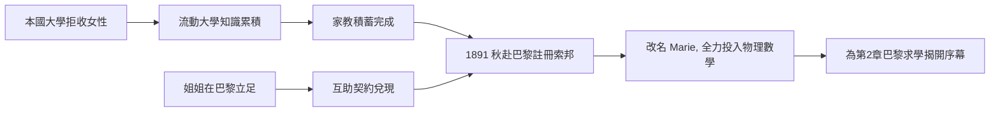

# 1.3 奔赴巴黎的決定

1891 年秋，24 歲的 Maria 登上開往巴黎的火車，攜帶的行李極少，學費與生活費主要來自多年家教積蓄與姐姐家的接濟。她在索邦（Sorbonne）以 Maria Skłodowska 之名註冊，進入理學院。這不是一時衝動，而是 1891 年春天她與 Bronya 通信、確認巴黎住處與生活安排後的計畫性行動。

出走的決定也包含對波蘭處境的判斷：留在華沙，她最多成為秘密講堂裡的優秀自學者；到巴黎，她能進入當時世界物理學的中心。法國雖仍有性別歧視，但相較之下是歐洲少數對女性開放大學之門的國家。這是「個人志向」與「制度窗口」的一次精準對位。

她抵法後把名字改為法文拼法 Marie，並刻意與波蘭僑胞圈子保持距離，以便全力投入學業——這顯示她已把「成為科學家」放在「流亡情緒」之上，但並未放棄波蘭認同：日後她將第一個發現的元素命名為「釙」（polonium），以紀念祖國。

**因果分析**：此節是第 1 章與第 2 章的樞紐。前兩節累積的知識、金錢與心理準備，在此兌換成一張火車票。若無波蘭的制度封鎖，她可能成為華沙的本地學者；正是「此地無門、彼地有窗」的落差，驅使波蘭人才流向巴黎，而 Marie 將這股流亡能量全部灌注到物理與化學，最終以新元素的命名反向回饋民族記憶。
