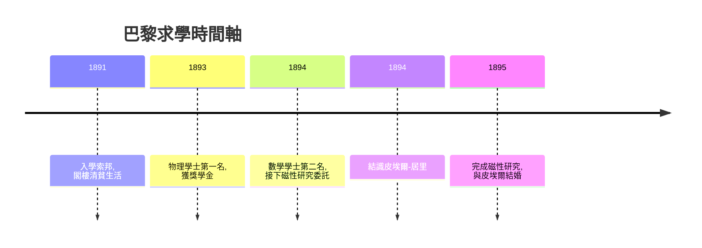

# 2.1 索邦的清貧生活

1891 至 1893 年間，Marie 住在巴黎拉丁區頂樓閣樓，冬夜冷到把所有衣物壓在被上，以整顆馬鈴薯或茶葉蛋充飢，曾因飢餓暈倒。她刻意削減一切開銷，只保留買書與煤油的錢。這種清貧不是被動的苦難，而是她主動的成本控制：學費與時間是唯一不能省的項目。

學業回報極為可觀。1893 年她以第一名取得物理學士學位，1894 年再以第二名取得數學學士學位。同期，她獲得一筆亞歷山德羅維奇獎學金（600 盧布）資助，使她能專心準備國家工業促進協會委託的鋼材磁性研究——這份委託既是她第一項正式研究，也直接促成她需要一間實驗室，從而認識皮埃爾。

**因果分析**：清貧→專注→雙學位→接案→認識皮埃爾，是一條環環相扣的因果鏈。金錢匱乏迫使她以學業效率補償；而求取學位的速度優勢，使她比同儕更早進入研究市場。磁性研究這一「計畫外的兼職」，反而成為她人生最關鍵的媒介事件——若非需要實驗室，她與皮埃爾未必相遇。貧困在此不是障礙，而是篩選機制，把她推向更高效率的軌道。
