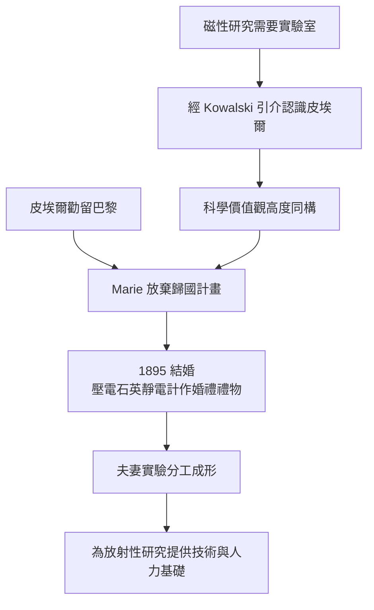

# 2.2 與皮埃爾的相遇與結合

1894 年春，為尋找進行鋼材磁性研究的實驗空間，Marie 透過波蘭裔物理學家 Kowalski 引介，認識了巴黎市立物理化工學院的皮埃爾·居里（Pierre Curie）。皮埃爾當時 35 歲，已以壓電效應（與兄長 Jacques 共同發現）與磁性研究（居里點）聞名，卻厭惡巴黎學術圈的浮華。兩人初見即發現彼此對科學的態度同構：研究即生活本身。

Marie 起初有意學成歸國服務波蘭；皮埃爾力勸她留在巴黎從事研究，並在通信中提出「科學上的共同生命」之願景。1895 年 7 月 26 日，兩人以極簡儀式結婚，Marie 著深藍便服婚宴只辦一桌。蜜月以自行車環法旅行取代傳統排場。婚後兩人形成實驗室分工：皮埃爾長於精密測量與儀器設計，Marie 長於化學分離與不懈的定量操作。

這段婚姻的結合條件並非浪漫巧合，而是三項因素疊加：Marie 需要實驗室與導師級的合作者；皮埃爾需要能與他同等投入、不干擾他研究的伴侶；兩人都視名望為干擾。這種價值觀同構，使婚姻成為科學生產力的放大器。

**因果分析**：壓電石英靜電計這件「結婚禮物」具有象徵與實質雙重意義——它正是日後測量放射性的核心儀器。婚姻在此不是私人事件的插曲，而是下一章科學突破的直接前置條件：沒有這段結合，就沒有可長期連續運作的實驗團隊，也就沒有 1898 年釙與鐳的發現。
