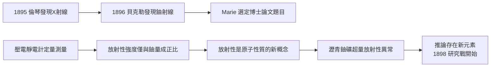

# 2.3 論文、釙與鐳的起點

1895 年 12 月，倫琴發現 X 射線；1896 年初，法國物理學家貝克勒（Henri Becquerel）發現鈾鹽能自發放出穿透性射線，使包黑紙的底片感光。這一現象被當時主流視為 X 射線的變體或磷光效應的餘波，研究迅速降溫。

Marie 正需一個博士論文題目。1897 年她在皮埃爾建議下選定「鈾射線」為題，關鍵的創新在於測量方法：她不用感光底片（定性），而用壓電石英靜電計測量射線使空氣導電的電流（定量）。這一選擇把模糊的物理好奇轉為可量化的科學對象。

1898 年初她得出兩項關鍵結果：其一，射線強度只與鈾含量成正比，與化合物形式、溫度、光照無關——她由此提出「放射性」概念，指出這是原子本身的性質；其二，釷也具有放射性。更重要的線索出現在 1898 年 4 月：她測得瀝青鈾礦（pitchblende）的放射性遠超其鈾含量所能解釋的程度，推論礦石中必含一種（或多種）放射性遠強於鈾的未知元素。

$$I \propto n_{\text{U}}, \quad I_{\text{pitchblende}} \gg I_{\text{純鈾等量}} \;\Rightarrow\; \text{存在未知強放射性元素}$$

**因果分析**：此節是全書的技術樞紐。「定量測量」這一方法論選擇，是發現鏈條的起點——正因為測得準，才測得出異常；正因為異常確鑿，才敢推論新元素存在。貝克勒提供了現象，倫琴提供了氛圍，皮埃爾提供了儀器，Marie 提供了把三者組織成「可檢驗假說」的方法論。第 3 章的一切，都由這條不等式驅動。
