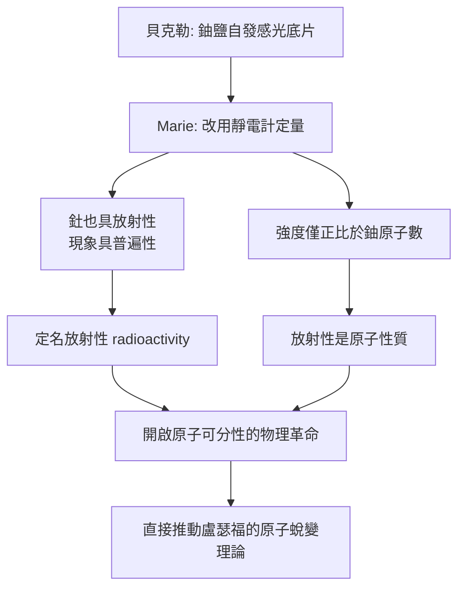

# 3.1 貝克勒射線與放射性概念

1896 年 2 月，貝克勒在研究鈾鹽螢光時偶然發現：硫酸鈾醯鉀即使不受光照、包在黑紙中，仍能使底片感光。他起初假設射線與螢光有關，隨後實驗推翻此說——射線與光照無關，且純金屬鈾的效應最強。這是史上第一次觀測到原子自發放出輻射，但貝克勒本人未能再往前推進：他缺乏量化手段，也缺乏對「現象普遍性」的追問。

Marie 的貢獻正在於接手這條被擱置的線索，並完成兩個概念躍遷。第一，她把「鈾射線」重新命名為「放射性」（radioactivity），並檢驗其是否為鈾獨有——測得釷亦具放射性，說明這是一類普遍的原子現象。第二，她證明放射性強度與化學狀態、溫度無關，只與原子數量成正比，由此推出：放射性源於原子內部，是「原子性質」而非分子或電子殼層性質。

$$I = k \cdot n_{\text{原子}} \quad (\text{與化合物種類、溫度、光照無關})$$

這一原子層級的結論在當時極具挑戰性：原子在主流化學中被視為不可分的最小單位，放射性卻暗示原子內部有結構、有能量釋放過程。它成為日後盧瑟福研究原子蛻變、最終導致原子核物理誕生的第一塊基石。

**因果分析**：概念命名看似修辭，實則是因果鏈的關鍵節點——把現象命名為「放射性」並確認其原子性，等於宣告存在一門新物理。若 Marie 停留在「鈾的特殊性質」，放射性將只是鈾的附屬現象；正因她驗證普遍性與原子性，後續尋找新元素（第 3.2 節）才有理論依據：既然是原子性質，放射性強度便可作為「元素指紋」用於化學鑑定。
