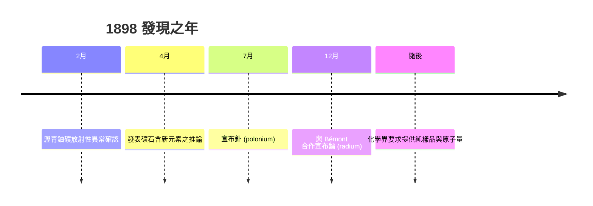

# 3.2 瀝青鈾礦中的新元素

1898 年，Marie 依據「放射性可作元素指紋」的邏輯展開搜尋。她測量多種礦物，發現瀝青鈾礦與銅鈾雲母的放射性遠高於其鈾含量所應有的數值，且人為合成同一成分的化合物時放射性消失——證明異常確實來自礦石中的未知成分，而非測量誤差。她由此寫下科學史上的關鍵推論：礦石中含有一種或數種放射性極強的新元素。

皮埃爾意識到結果的重大，放下自己的磁性研究加入。1898 年 7 月，兩人以化學分離配合放射性追蹤，從礦石中分出放射性為鈾數百倍的成分，化學性質近鉍，命名為「釙」（polonium），致敬 Marie 的祖國波蘭。同年 12 月，又分出放射性近鈾百萬倍、性質近鋇的成分，命名為「鐳」（radium），並與 Gustave Bémont 合作發表。

$$I_{\text{釙}} \approx 400 \times I_{\text{U}}, \qquad I_{\text{鐳}} \approx 10^6 \times I_{\text{U}}$$

但當時化學界的主流質疑是：只有放射性證據，沒有純淨樣品與原子量測定，憑什麼稱為「元素」？這一質疑合理且嚴峻，直接引出下一節的巨大工程——提煉純鐳並測定其原子量。

**因果分析**：放射性指紋法是方法論核心——用物理量（輻射電流）引導化學分離方向，等於在黑暗中擁有一盞燈，能追蹤百萬分之級的痕量成分。釙的命名則把科學發現轉化為政治表態：在波蘭尚未復國的年代，以亡國之名命名新元素，使科學期刊成為民族主義的載體。而化學界的質疑雖構成阻力，卻反向驅動了更嚴謹的工作，成為提煉工程的直接起因。
