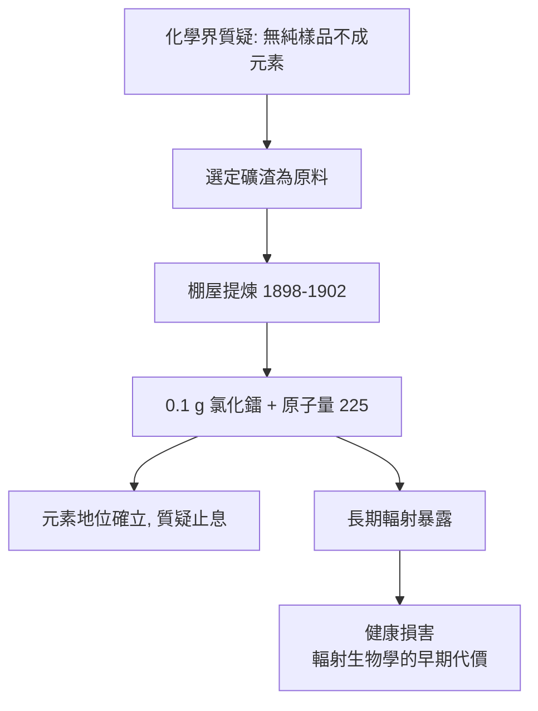

# 3.3 噸級礦渣與 0.1 克鐳

為回應化學界的質疑，居里夫婦自 1898 年起展開提煉工程。原料選定奧地利波希米亞聖約阿希姆斯塔爾（Joachimsthal）礦場提鈾後廢棄的瀝青鈾礦渣——鐳含量極低但價格低廉，且奧地利政府同意以學術名義提供數噸礦渣。這一選擇兼具科學與經濟理性：既然鐳極微量，必須以噸為單位起算。

他們在巴黎市立物理化工學院一間漏雨的簡陋棚屋中作業，歷時近四年：先酸溶礦渣，再以硫化物分組沉澱、分步結晶等經典化學方法反覆分離。Marie 主要負責液體處理與結晶，常一次攪拌數十公斤沸騰溶液；皮埃爾專注放射性測量與精煉細部。1902 年，他們終於獲得 0.1 克氯化鐳，測定鐳原子量約為 225，並觀察到鐳鹽在黑暗中發光的奇景。

$$\text{數噸礦渣} \;\longrightarrow\; 0.1\ \text{g RaCl}_2 \quad (\text{富集倍數}\sim 10^7)$$

這 0.1 克樣品使質疑止息：元素的存在、原子量、光譜線俱全。但代價沉重——兩人長期暴露於高強度輻射與鐳鹽氣溶膠，Marie 的手指出現潰瘍、灼傷，健康開始受損。他們當時並未意識這些症狀正是輻射生物效應的直接證據，甚至 Marie 遺願將筆記本保存於鉛盒，至今仍具放射性。

**因果分析**：本節呈現科學史上「證據成本」的極端案例——為取得 0.1 克證據付出四年體力勞動與終身健康。經濟邏輯（用廢礦渣降低原料成本）與科學邏輯（原子量測定終結質疑）在此互為支撐。同時，棚屋的艱苦條件埋下兩條伏線：一是輻射傷害的長期積累（第 5.3 節），二是 1903 年諾貝爾獎的學術積累基礎（第 4.1 節）。
