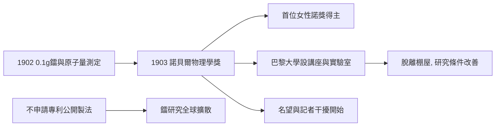

# 4.1 1903 年諾貝爾物理學獎

1903 年 12 月，瑞典科學院將諾貝爾物理學獎一半授予貝克勒，另一半共同授予皮埃爾與 Marie 居里，表彰他們「對亨利·貝克勒教授所發現射線的共同研究」。Marie 是史上首位女性諾貝爾獎得主。

授獎過程本身即反映當時的性別結構。最初提名僅列皮埃爾與貝克勒；經皮埃爾去信抗議，指出放射性概念的提出與化學分離工作主要由 Marie 完成，瑞典科學院才補入 Marie 之名。法國官方亦起初未邀請 Marie 隨行赴斯德哥爾摩。這些細節顯示：Marie 的貢獻雖在論文署名上清晰可查，卻需丈夫主動聲明才被制度看見。

得獎帶來的直接後果有二。其一是資源改善：巴黎大學為皮埃爾設立講座並配置實驗室，聘 Marie 為實驗室主任；兩人得以脫離棚屋。其二是「名望干擾」的開始：記者、訪客湧入，皮埃爾對此極為厭惡，Marie 則學會以沉默應對。兩人一度拒絕為鐳的製備方法申請專利，公開公布提煉流程，認為「科學屬於全人類」——此決定使他們放棄了可觀的財富，卻使鐳的研究迅速全球擴散。

**因果分析**：諾貝爾獎是第 3 章積累的兌現，也是第 4 章張力的起點。制度性的性別忽視（提名漏列、邀請缺席）與學術榮耀並存，預示 Marie 日後必須以更強的獨立身份對抗結構。放棄專利的決定則體現「科學公共性」的價值選擇——它削減家族財富，卻換取鐳治療與核科學的加速傳播，屬於典型的「以私利換公共品」的因果交換。
