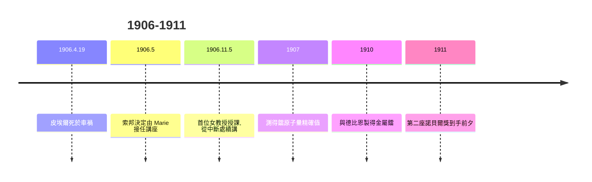

# 4.2 皮埃爾之死與接任教席

1906 年 4 月 19 日，皮埃爾在大雨中的達姆街被馬車輾過頭顱，當場身亡，得年 47 歲。Marie 失去的不僅是丈夫，也是唯一的科學合作者與精神支柱。她一度陷入嚴重抑鬱，在日記中以文字與亡夫對話數月之久。

巴黎大學隨後作出歷史性決定：將皮埃爾的講座授予 Marie，使她成為索邦史上首位女教授。她接任的條件是講座須附設實驗室——這正是她與皮埃爾長年爭取而未得的條件。1906 年 11 月 5 日，她登上皮埃爾的講席，第一句話不談哀悼，直接從上一堂課的中斷處繼續講授，以科學的連續性作為對亡者最忠實的紀念。

接任教席具有多重意義：制度上，法國最高學府首次由女性執掌物理講座，開創先例；科學上，她獲得獨立指揮研究團隊的權力，得以系統培養年輕研究者——包括她的學生與日後的接棒者；個人層面，她把喪夫的巨大情感能量轉化為工作強度，繼續推進鐳的化學與放射性測量，於 1907 年測得鐳原子量 226.2 的精確值，並於 1910 年與德比恩（André Debierne）合作製得金屬鐳。

**因果分析**：悲劇與制度突破互為因果——若非皮埃爾死亡，講座極可能不會交到 Marie 手中；這是性別歧視結構下罕見的「悲劇性窗口」。而 Marie 以「續講未完之課」回應，把私人哀傷編入科學傳承的敘事，展現情感與工作的高度整合。金屬鐳的製得則是 1911 年化學獎的直接前置工作，使喪夫後的四年成為她學術產出的高峰之一。
