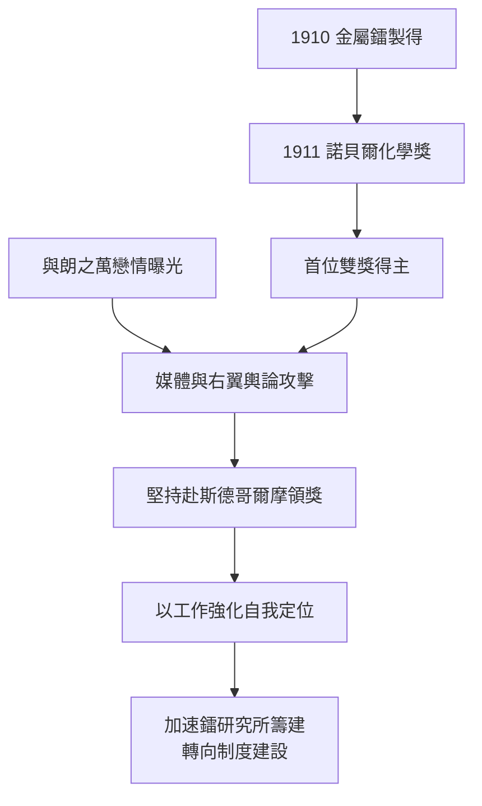

# 4.3 1911 年諾貝爾化學獎與風波

1911 年，瑞典科學院授予 Marie 諾貝爾化學獎，表彰她發現釙與鐳、分離純鐳並測定其原子量，以及研究鐳的化合物性質。她因此成為史上首位兩度獲諾貝爾獎者，且橫跨物理與化學兩個不同學科——此紀錄在女性科學家中至今罕有匹敵。

同年她遭遇人生最猛烈的輿論風暴。法國媒體曝光她與物理學家保羅·朗之萬（Paul Langevin，皮埃爾昔日的學生，已婚並育有子女）的戀情，右翼報紙以「外國人」「猶太血統」（不實）「破壞家庭」等角度攻擊，甚至有暴民在她住宅外騷擾。她的瑞士籍同行勸她暫緩赴斯德哥爾摩領獎，她回覆：獎是因科學工作而頒，與私生活無關，她堅持前往。愛因斯坦也在信中寫道：如果有些人以名人的私生活為樂，就讓他們去吧，她應當繼續走自己的路。

科學成就與社會攻擊形成尖銳對照。這場風波的實質，是當時社會對「女性+外國人+獨立學者」三重身分的聯合懲罰機制：她的每一項越界（女教授、兩獎得主、公開戀情）都被放大為道德事件。風波也直接催化了後續制度建設——她加速投入鐳研究所的籌建，以實驗室而非輿論作為安身之所。

**因果分析**：雙獎的學術根基分別來自第 3 章（放射性與元素發現）與第 4.2 節（金屬鐳與原子量），顯示她的兩座獎並非運氣疊加，而是兩條工作線的各自成熟。輿論風暴則揭示結構性偏見：學術界能接受她的成果，社會難以接受她的主體性。她以「領獎是對科學的回應」完成道德反擊，並將創傷轉化為建設——研究所與戰時救護（第 5 章）皆由此轉折驅動。
