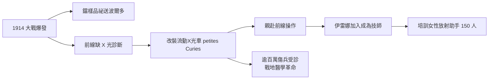

# 5.1 一戰 X 光車與前線救護

1914 年 8 月第一次世界大戰爆發，德軍逼近巴黎。Marie 立即放下個人與研究所的安危，意識到戰場外傷診斷急需 X 光設備，而前線醫院幾乎無一配備。她以最快的速度完成兩件事：其一，說服政府將研究所的鐳樣品（約 1 克）祕密護送至波爾多保管，避免落入敵手；其二，親自投入流動放射診斷的建設。

她將普通轎車改裝為裝載 X 光機與發電機的「小居里」（petites Curies），首批約 20 輛，自己學會駕駛、X 光操作與人體解剖定位，直接開赴前線。她設立 200 多個放射站，並培訓約 150 名女性助手。她的女兒伊雷娜（Irène，時年 17 歲）加入母親的工作，成為前線 X 光技師。估計整個戰時，這套體系服務了逾百萬傷兵的診斷。

$$\text{診斷效率} \uparrow \;\Longleftrightarrow\; \text{彈片定位時間} \downarrow \;\Rightarrow\; \text{手術存活率} \uparrow$$

值得一提的是，她把自得的諾貝爾獎章與獎金也投入戰爭公債與救護，並推廣「鐳射氣（radon）管」用於局部消毒與止痛的戰時醫療應用。

**因果分析**：此節顯示她將科學資源轉化為戰時公共品的能力：鐳的「保存」與 X 光的「出擊」是同一個資源配置決策的兩面。伊雷娜的前線經歷，則是母女科學傳承的關鍵節點——17 歲的戰地實務，使伊雷娜日後自然接手放射性研究，最終同樣獲得諾貝爾化學獎。戰爭既是災難，也是她進入醫學物理領域、並完成代際培養的催化劑。
