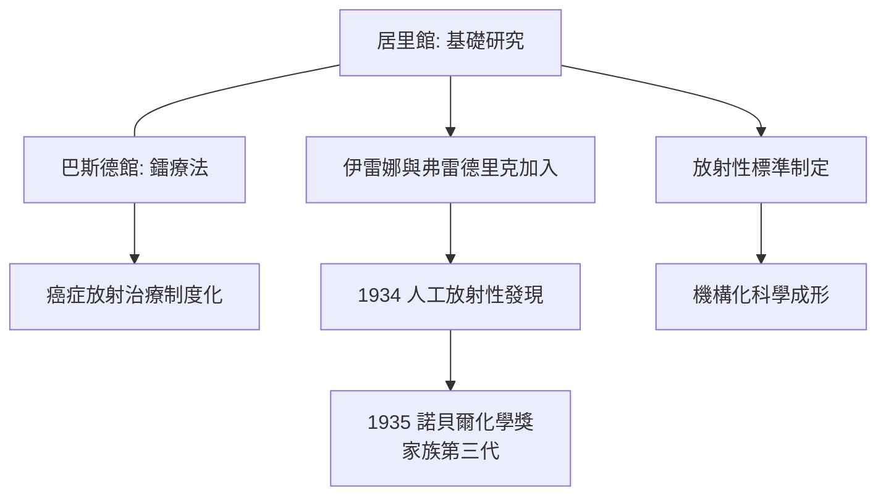

# 5.2 鐳研究所與伊雷娜接棒

戰後，Marie 積極推動「鐳研究所」（Institut du Radium）的建成：巴黎居里館（Pavillon Curie，皮埃爾·居里街）於 1914 年落成，毗鄰巴斯德研究所附設的釙治療館。她的構想是雙軌結構——居里館負責放射性基礎研究，巴斯德館負責鐳療法的醫學應用，使基礎科學與臨床治療在同一園區內互相餵養。

研究所的建立體現她的制度眼光：她主動與國際聯盟文化委員會合作，協助制定放射性標準與國際計量；並推動國際學術基金（如她 1921 年訪美募款——美國婦女募捐 1 克鐳贈予她，以供研究）。這些制度安排使放射性研究從個人事業轉型為可傳承的機構科學。

傳承的核心是伊雷娜·約里奧-居里（Irène Joliot-Curie）。伊雷娜自幼在實驗室長大，戰時已為 X 光技師，1920 年代進入母親團隊工作，1934 年與丈夫弗雷德里克·約里奧-居里以 $\alpha$ 粒子轟擊鋁，發現人工放射性，翌年同獲諾貝爾化學獎——居里家族的第三代傳奇由此寫成。Marie 對此評價簡短而自豪：這是她一生看過最好的「科學血統」延續。

**因果分析**：一戰的救護經驗（第 5.1 節）證明了放射性醫學的價值，反向加強了研究所雙軌結構的合理性。伊雷娜的接棒則非偶然：前線 X 光經驗提供實務基礎，家庭實驗室提供訓練環境，人工放射性這一課題正是母親放射性研究的自然延伸。居里夫人的制度建設使她的科學方法得以「去個人化」複製，這是她留給 20 世紀核科學最持久的資產之一。
