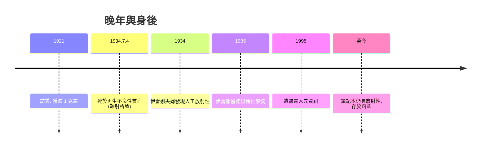

# 5.3 輻射傷害、逝世與遺產

Marie 晚年健康持續惡化：視力白內障、耳鳴、骨髓與血液異常，皆為長年高劑量輻射暴露的結果。她晚年實驗室已測得放射性對生物體的破壞，但因當時輻射防護知識尚未建立，她本人未曾系統防護——甚至將盛鐳的試管放在口袋、讓學生觸摸發光的鐳鹽。1934 年 7 月 4 日，她因再生不良性貧血逝世於法國薩朗什（Sancellemoz）療養院，得年 66 歲。醫師診斷確認病因與長期輻射暴露直接相關。

她去世的同年，伊雷娜與弗雷德里克發表人工放射性——可視為居里科學血脈在母親生命終點完成的接力。1995 年，法國政府將她與皮埃爾的遺骸遷入巴黎先賢祠，她成為首位憑自身成就入祠的女性。她的實驗筆記至今仍具放射性，存於鉛盒中，讀者須簽署免責並穿防護裝備方可查閱——這是科學史上最沉重的「遺物」。

她的遺產可分三層：科學層面，放射性概念、釙與鐳、原子蛻變的前置工作，直接鋪墊了核物理、核醫學與放射化學；制度層面，鐳研究所、放射性國際標準、女性進入科學殿堂的先例；精神層面，「科學屬於全人類」與不申請專利的公共品立場。

**因果分析**：輻射傷害與她的科學成就是同一件事的兩面——發現放射性的人，必然以自身為第一批實驗對象。她的死反過來推動了輻射防護學的建立：劑量限值、鉛屏蔽、實驗室安全規範在 1920-30 年代加速制度化。居里夫人的一生由此閉環：亡國之女以科學立身，發現了改變物質觀的現象，以身體為代價，最後以制度與血脈延續其方法——個人悲劇轉化為公共安全規範，正是她遺產中最深的一層因果。
