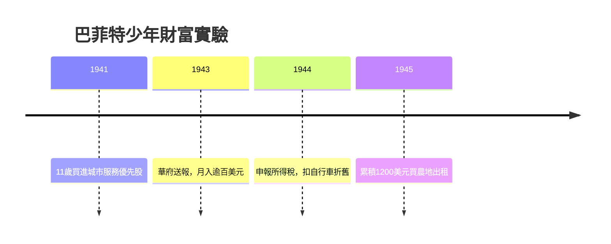

# 1.2 送報路線與複利啟蒙

十一歲那年，巴菲特買進人生第一張股票「城市服務優先股」，以每股38美元買入，漲到40美元就賣出；該股隨後漲破200美元。這次「賺太快」的教訓，讓他終生記住：過早下車的機會成本遠比虧損更折磨人，耐心本身就是資產。

中學時期他在華府送《華盛頓郵報》，透過規劃路線、爭取訂戶、銷售月曆與集郵冊，月收入超過許多成年人。他把送報收入累積成一千二百美元，並用這筆錢買下四十英畝內布拉斯加的農地出租。更關鍵的是，他在送報時接觸到巴貝森與各種商業刊物，開始思考「錢如何自己生出錢」。十四歲時他申報所得稅，發現可以扣除自行車折舊——對制度細節的敏感自此成為本能。

複利是他最早參悟的宇宙法則。他在送報途中反覆計算：如果一筆錢以固定的年利率滾動，數十年後將膨脹成什麼規模？他甚至在年老後仍說，複利公式是他一生最重要的公式：

$$FV = PV(1+r)^n$$

其中未來價值 $FV$ 取決於本金 $PV$ 、報酬率 $r$ 與時間 $n$ 。他明白了 $r$ 與 $n$ 都在指數位置——這意味著「活得久、穩定報酬」勝過「一次暴利」。

## 因果分析

早賣的遺憾→長期持有哲學：第一次股票交易因急售錯失十倍漲幅，這個創傷直接轉化為日後「買進並長期持有」的紀律。
送報→規模化思維：路線優化與訂戶擴張，是企業經營（收入結構、邊際成本）的預演，也累積了第一桶本金。
複利公式→時間觀： $(1+r)^n$ 讓他把注意力從「賺多少」轉向「能複利多久」，這成為一生投資架構的數學基石。
