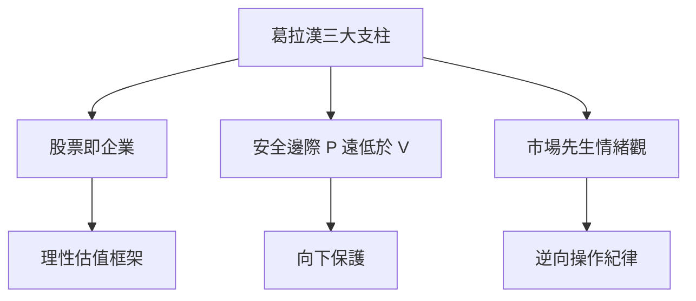

# 2.1 哥倫比亞商學院與葛拉漢門下

1950年秋天，二十歲的巴菲特進入哥倫比亞商學院。他成為葛拉漢課堂上最激進的學生：上課前已讀完《證券分析》至少一遍，課堂上幾乎搶答所有問題，葛拉漢自嘲是唯一在該課程拿過A+的學生。葛拉漢的教學不是背公式，而是拆解實際案例：如何從財報挖出隱藏資產、如何界定清算價值、如何在市場恐慌中系統性地撿「菸蒂」——那些股價低於清算價值、抽完最後一口仍有免費煙灰的公司。

葛拉漢思想的三大支柱深刻塑造了巴菲特：一是「股票即企業」，投資是買下企業的部分所有權，而非猜測明天的報價；二是「安全邊際」，以數學方式表達即

$$\text{安全邊際} = V - P \quad (P \ll V)$$

其中 $V$ 為估算的內在價值， $P$ 為買進價格；三是「市場先生」的情緒觀：市場報價是服務你的僕人，不是指導你的老師。巴菲特畢業後曾無償要求為葛拉漢工作，卻被婉拒（葛拉漢當時優先錄用猶太裔，以抗議業界歧視），他只得先回到家鄉父親的券商上班。

## 因果分析

無償求職被拒→奧馬哈沉潛期：被拒反而迫使他回家鄉實習葛拉漢方法，期間應用「菸蒂投資」於堪薩斯城市壽險等標的，賺到實戰第一票，驗證了課堂理論。
求職執念→重返紐約：他持續寫信向葛拉漢提供股票點子，鍥而不捨的價值分析報告最終打動葛拉漢，於1954年錄用他——這說明巴菲特早期的一切行動，都是圍繞「接近師門」這一目標驅動的。
葛拉漢量化框架→日後演化的伏筆：純量化、分散化的菸蒂法在巴菲特手中終將因資金規模與蒙格的影響而質變，但此時他先完全內化了老師的體系。
