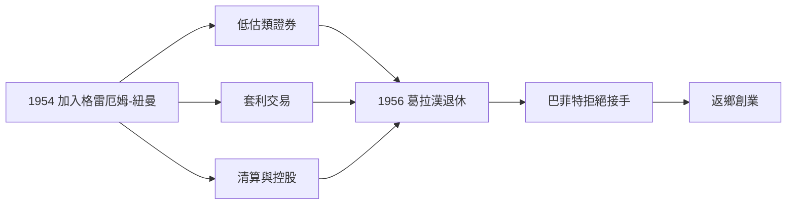

# 2.2 格雷厄姆-紐曼公司的歷練

1954年，巴菲特終於如願加入紐約的格雷厄姆-紐曼公司，擔任證券分析師。這是一家近乎神秘的小型合夥基金，葛拉漢與傑瑞．紐曼以嚴格的統計紀律操作：買進股價低於清算價值或營運價值的公司，從事套利、清算與控股改造，不與管理層談願景，只與數字打交道。

巴菲特在這裡的兩個代表案例極具教育意義。其一是「費城與雷丁煤鐵公司」，他買進股價低於每股現金資產的公司，等待清算還本；其二是「聯合街道電車公司」（Commonwealth），透過分散買入獲得鉅額報酬。他逐漸掌握了葛拉漢從事的三類操作：低估類證券、套利交易與清算控股。同期他也觀察到老師的局限——葛拉漢要求徹底分散、不參與經營、賺到統計利潤就走；巴菲特則越來越渴望深入少數公司、了解它們如何真正賺錢。

1956年，葛拉漢決定退休並提出讓巴菲特合夥接手，出人意料的是巴菲特拒絕了。原因有二：他不想背負「葛拉漢第二」之名，更重要的是他決定回到奧馬哈獨立創業。

## 因果分析

工坊歷練→方法內化：在格雷厄姆-紐曼的兩年，讓巴菲特從「讀懂理論」升級為「執行交易」，並驗證了菸蒂法確實能賺錢，這是日後獨立創業的信心基礎。
老師的局限→門徒的分岔：分散、機械化的操作方式與巴菲特「集中、深入、長期」的天性不符；葛拉漢的退休不是分岔的原因，而是分岔的時機——差異早已存在。
拒絕接手→1956返鄉：若他留在紐約接下招牌，就沒有巴菲特合夥事業的自由設計；正是「不做葛拉漢第二」的堅持，催生了屬於他自己的架構。
