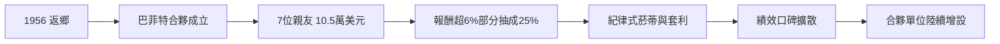

# 2.3 重返奧馬哈與創業抉擇

1956年5月，二十五歲的巴菲特帶著妻子蘇珊與年幼的孩子回到奧馬哈，在法納姆街的家中成立「巴菲特合夥事業」。創業的資本結構耐人尋味：他自己只象徵性地出資100美元，其餘來自七位親友共十萬五千美元——父親、姑姑、岳父、姐姐與同窗好友。收費結構是日後傳奇的關鍵：每年收益超過6%的部分，巴菲特抽成25%；虧損年份則虧損結轉，他的報酬幾乎全部來自「超越無風險利率的表現」，風險與報酬高度對齊。

選擇奧馬哈而非紐約，是深思熟慮的反向決策：遠離華爾街的噪音，等於把自己隔離在「市場先生」的情緒傳染之外，正好實踐葛拉漢「市場只是僕人」的教誨。他在頭幾年嚴格執行葛拉漢式的菸蒂策略，買進桑伯恩地圖等低價控股標的，也進行套利。合夥事業頭年的報酬率遠超市場，投資人開始加碼，他再設立新的合夥單位。

## 因果分析

遠離紐約→情緒隔離：物理距離轉化為心理距離，使他能逆著市場情緒操作，這個地理選擇與投資哲學互為因果。
費用結構→規模擴張：抽成機制讓巴菲特有強烈動機追求超額報酬，也讓早期投資人獲得真實利益，口碑滾動帶來更多資金——資金增加又反過來迫使他思考「規模是報酬率的敵人」。
早年績效→信任資本：1957至1959年合夥大幅跑贏道瓊指數，奠定了他在1960年代能持續募集資金、乃至後來掌控波克夏的信用基礎。創業決策看似微小，實為整個波克夏帝國的第一因。
