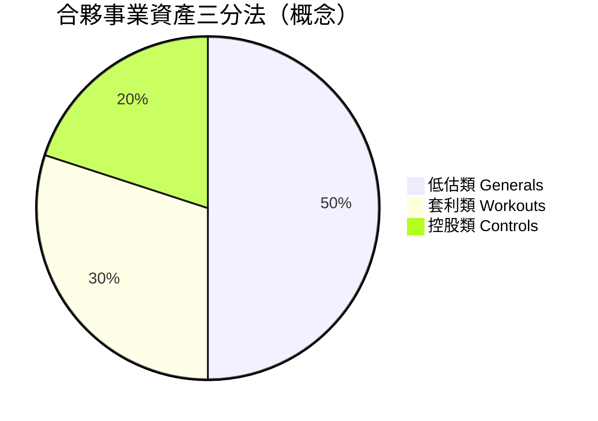

# 3.1 巴菲特合夥事業的成立與運作

1960年代的巴菲特合夥事業，是「葛拉漢方法＋巴菲特變異」的實驗室。他把資產分為三類：低估類（Generals）、套利類（Workouts）與控股類（Controls）。低估類買進股價遠低於內在價值的公司；套利類賺取併購、清算等事件的價差，報酬與大盤無關，提供組合的穩定器；控股類則是在低估類買到足夠多股份後，介入經營以釋放價值。這個三分法本身就是風險管理：套利類的零貝塔特性，讓組合在熊市仍有表現。

代表案例包括桑伯恩地圖公司：股價因本業衰退而低廉，但公司資產負債表上藏著一大筆證券投資組合。巴菲特合夥買進控股地位，迫使公司把投資組合分配給股東，實現價值。這是他第一次以股東身分對抗管理層，體會到「買便宜」與「逼價值出來」是兩回事。另一個案例是登普斯特磨坊，他甚至聘請芒格推薦的哈利．博特爾整頓營運、變賣低效資產。

## 因果分析

三分法→牛市熊市皆可運作：套利類與大盤無關，低估類在恐慌中最好撿貨，控股類為極端低估提供退出機制——三類互補使合夥事業在1962年古巴飛彈危機的熊市中仍創造正報酬，跑贏道瓊逾兩成。
桑伯恩→控股思維的覺醒：被迫對抗管理層的經驗，讓巴菲特理解「市場價格未必會自己修正」，價值實現有時需要主動作為，這為日後整體收購埋下種子。
登普斯特→對「拆賣」的道德反思：變賣家鄉小鎮工廠的資產雖然賺錢，卻招致負評，這種不適感悄悄推動他遠離「清算別人生意」的菸蒂模式，為接受蒙格的「買好公司」路線提供心理條件。
