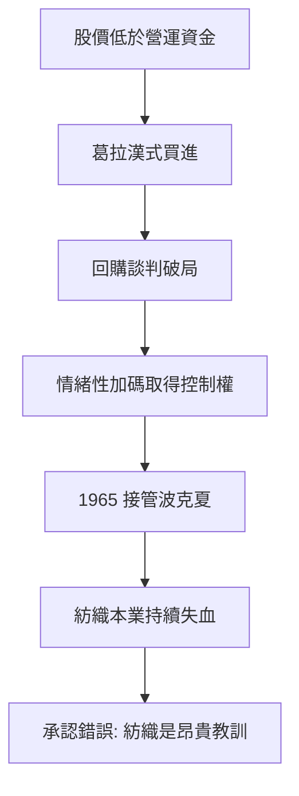

# 3.2 收購波克夏海瑟威與紡織之誤

1962年，巴菲特開始買進波克夏海瑟威（Berkshire Hathaway）——一家新英格蘭紡織廠，因外國廉價競爭而年年失血，股價遠低於營運資金。依葛拉漢式思維，這是典型的菸蒂：公司雖在萎縮，清算價值仍在。他與管理層史坦頓曾約定回購價格，對方事後反悔、壓低報價，巴菲特怒而反手大量買進，竟取得控股權，並於1965年正式接管。這場「報復性收購」日後被他自嘲為職涯最昂貴的情緒化交易——因為那是「以便宜的價格買下一門正在死亡的生意」。

紡織本業的困境是結構性的：美國紡織業的比較優勢早已移往海外，資本再投入的報酬率低得可悲。巴菲特起初仍試圖搶救，甚至收購同業以規模求存，終究認清：好管理者遇上壞行業，壞行業的名聲不變。他學到的核心教訓是——時間是好公司的朋友，是平庸公司的敵人；把資本持續投入低報酬資產，複利公式中的 $r$ 就會被拖垮：

$$r_{\text{整體}} = w_1 r_1 + w_2 r_2$$

當權重 $w_1$ （紡織）的 $r_1$ 長期趨近零甚至為負，整體報酬必然被侵蝕。

## 因果分析

回購毀約→憤怒收購：情緒觸發的加碼，讓一筆小套利變成龐大控股；若無那口氣，巴菲特可能根本不會擁有波克夏。
錯誤本業→被迫轉型：紡織的持續失血製造了「必須找到新報酬引擎」的壓力，這種壓力驅動他把保險、銀行等資產裝入波克夏——紡織之誤因禍得福地成為控股轉型的載體。
教訓內化→投資哲學升級：「以合理價格買好公司」勝過「以便宜價格買平庸公司」的領悟，正是從這個數十億美元級的錯誤中生長出來的。
