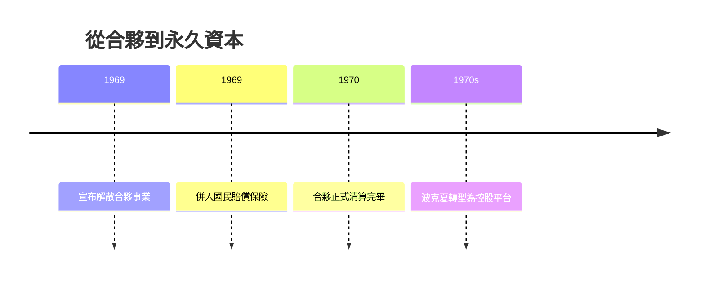

# 3.3 合夥解散與控股轉型

1969年5月，三十九歲的巴菲特做了一個震撼投資界的決定：解散合夥事業。他在寫給合夥人的信中坦言：「我找不到值得投資的標的。」當時市場充斥著綜合企業概念股與投機狂熱，本益比飛天，葛拉漢式安全邊際已無處容身。他寧願退出，也不願拿別人的錢去玩自己不懂的遊戲——這份紀律成為他信譽的基石。

解散過程展現誠信：他把大部分持股轉換為實物分配，讓合夥人自選持有波克夏、多元零售等公司股票，或以現金退出。巴菲特自己保留了波克夏的控股權。這個安排的因果意義重大：合夥事業的結束，正是波克夏作為「永久資本載體」的開始。合夥需要年年向出資人報告並面對贖回壓力，而上市公司（或控股公司）的資本可以「永久閉鎖」，這正是巴菲特實現長期複利所需的結構條件。

1960年代末，他已把國民賠償保險公司併入波克夏；1970年代初期，他正式讓紡織退居次要、以波克夏為控股平台。資金性質的改變——從「隨時可能被贖回」到「可以三十年不動」——使複利公式中的 $n$ 得以真正發揮威力。

## 因果分析

市場狂熱→主動退出：找不到符合安全邊際的標的，是他解散合夥的直接原因；寧可放棄管理費也不妥協，換來終生的投資人信任。
贖回壓力→永久資本需求：合夥結構的短錢與長期價值投資天然衝突，解散合夥、改用波克夏閉鎖資本，是結構上解決這個矛盾的唯一途徑。
資本閉鎖→複利釋放：資金不會中途抽走， $n$ 得以拉長，波克夏每股帳面價值此後數十年以近20%年化成長——合夥的「結束」恰恰是帝國的「開始」。
