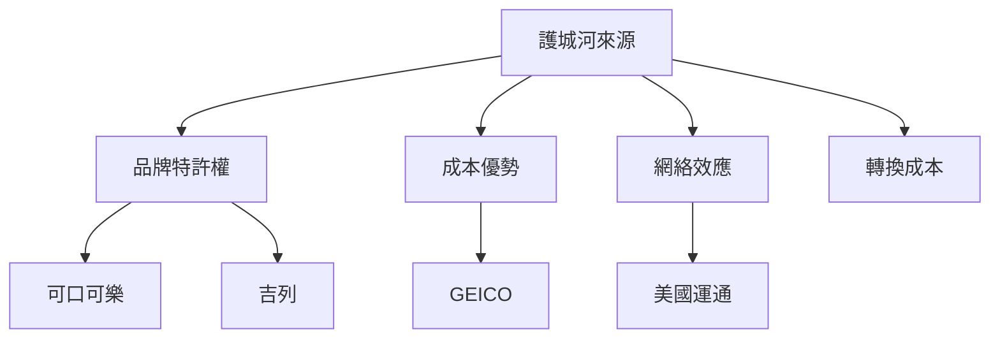

# 4.3 可口可樂、吉列與護城河投資

1988至1989年，波克夏以約13億美元買進可口可樂約7%股權，每股成本約10.96美元（拆股調整後）。當時可樂本益比不算便宜，但巴菲特已完全轉向蒙格式思維：品牌特許權、全球分銷網、極低的資本需求與長期定價能力，構成寬深的護城河。以簡化的永續成長估值模型看：

$$V = \frac{FCF_1}{r - g}$$

可樂的自由現金流長期穩定成長，$g$ 高而持久，$r$ 因確定性極高而低，$V$ 自然遠高於市價。此後可樂持股未曾賣出，僅股息就數倍於原始投資。

1991年，他受邀進入吉列董事會，波克夏陸續買進吉列股票，後於2005年吉列併入寶鹼時換股增值。此外美國運通（1990年代加碼）、富國銀行等，共同構成「消費特權＋金融」的組合。這些標的的共同點是：消費者心智中的壟斷地位（心智市占率）、重複購買、抗通膨定價權。巴菲特在股東信中把企業分為「特許事業」與「大宗商品事業」：前者定價自由、報酬率高；後者只能比拚成本，報酬注定平庸。

## 因果分析

喜詩的課→可樂的倉：沒有喜詩糖果驗證品牌特權的威力，就不會有1988年「以合理價買進」可樂的果斷；前一個案例是後一個案例的因。
浮存金→大額持股的可行性：數十億浮存金使他有能力建立市場難以撼動的持股規模，並以董事會席位深度參與治理。
確定性→低折現率：對護城河的信心降低 $r$、拉高 $V$，使「貴」變成「合理」；而他長期持有的紀律，又把紙上的 $g$ 真正兌現為數十年的複利。哲學、資金與時間，三環相扣。
