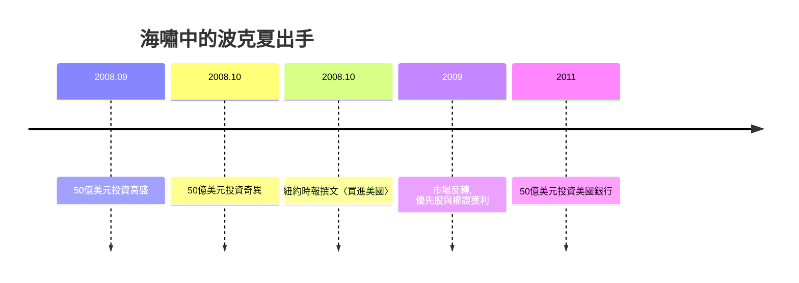

# 5.1 金融海嘯中的出手

2008年金融海嘯，是巴菲特一生中第三次「趁恐慌進場」的歷史性時刻（前兩次可對應大蕭條教育與1974年熊市）。當市場因雷曼倒閉而凍結時，波克夏的資產負債表成了全美最被信賴的現金堡壘：數百億美元現金與保險浮存金，正是他數十年保守財務政策的果實——「別把危機變成破產」的準備，使他能把別人的恐慌變成自己的機會。

2008年9月，波克夏以50億美元投資高盛，取得10%股息的優先股與認股權證；10月，再以50億美元投資奇異（GE），條件相仿；同期也參與陶氏化學等交易。這些交易的共同結構是「優先股＋高股息＋權證」：在承擔風險的同時鎖定確定收益，並保留上檔空間——恐慌越深，賣方的條件越慷慨。他同時在《紐約時報》發表〈買進美國〉專欄，宣稱「現在是買進美股的好時機」。2011年，他又宣布買進美國銀行50億美元優先股，重演同一劇本。

## 因果分析

數十年保守資本政策→危機中的議價能力：波克夏不舉債豪賭、現金常備，這份「無聊」在平常是拖累，在危機中變成最稀缺的談判籌碼。
恐慌→慷慨條款：賣方急於信用與現金，使優先股條款（10%股息＋權證）對買方極度有利；危機深度直接轉化為報酬率。
名望→Deal Flow：巴菲特「最後貸款人」式的公信力，讓高盛、奇異主動上門——名譽本身成為資產，這是長期信譽投資的複利回報。
