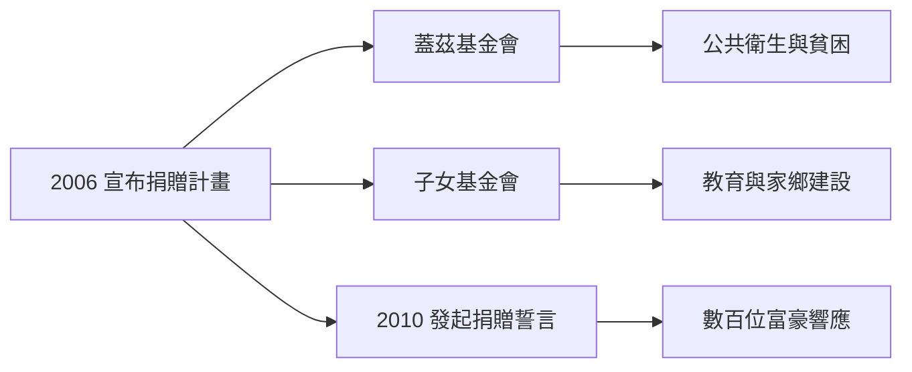

# 5.2 慈善承諾與捐贈誓言

巴菲特對財富的態度，與他對資本的態度一以貫之：錢是複利的載體，最終要流向最有效率的用途。2006年6月，他宣布將把絕大部分財富捐給慈善事業，主要透過逐年轉讓波克夏B股給比爾與梅琳達．蓋茲基金會，以及由其三名子女主持的基金會。此舉金額約達數百億美元，是史上最大單筆慈善承諾。

2010年，他與蓋茲共同發起「捐贈誓言」（The Giving Pledge），邀請全球億萬富翁公開承諾捐出至少一半財富，數百位富豪響應。巴菲特的慈善哲學同樣講究「配置效率」：他認為蓋茲基金會在公共衛生與貧困領域的執行力，勝過自設機構，因此把錢交給「報酬率最高」的慈善經理人——這本質上是投資組合思維在公益領域的延伸。

$$\text{社會報酬} = \sum_i w_i \cdot r_i^{\text{社會}}$$

他以此邏輯決定捐款權重 $w_i$：誰能讓每一美元產生最大的社會效益，就把錢給誰。晚年他更明確表示死後遺產將由子女在十年內捐罄，不留長期官僚化的基金會。

## 因果分析

對遺產稅與繼承的長期批判→捐贈哲學：巴菲特反對「世襲富豪」，認為運氣性的財富應回饋社會；這一價值觀驅動了捐贈計畫的結構設計。
信任蓋茲基金會→善款外部化：他不自建慈善帝國，而將資金配置給已驗證的執行者，再次體現「集中投資於最優管理者」的風格。
捐贈誓言→槓桿放大：以自身名望號召他人承諾，是慈善版的護城河效應——個人捐款是線性，改變富人群體的規範是指數。
