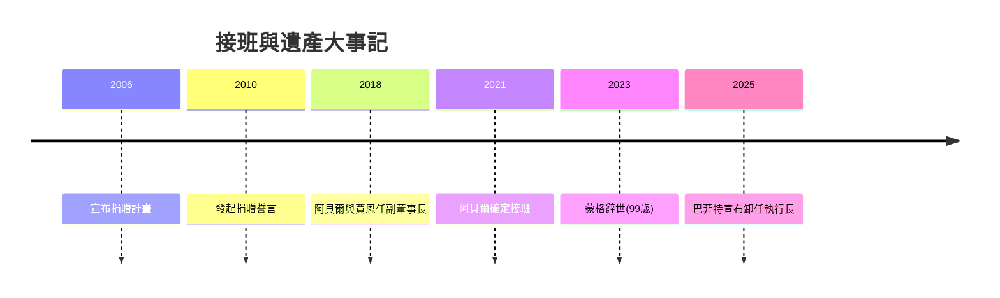

# 5.3 接班安排與巴菲特的遺產

晚年的巴菲特持續解決兩個問題：資本由誰配置、事業由誰經營。2010年代起他逐步交棒：2018年提拔阿貝爾與賈恩為副董事長，分別統管非保險事業與保險業務；2021年確定阿貝爾將接任執行長，賈恩掌投資資本配置協助；蒙格於2023年以九十九歲辭世，巴菲特本人也在2025年於股東大會上宣布自年底卸任執行長，由阿貝爾接棒，自己保留董事長職位監督投資決策。接班設計的核心是分離「經營權」與「資本配置權」，並維持波克夏「永久資本、分散控股、保留現金」的文化。

巴菲特的遺產可以濃縮為幾個公式與原則：複利 $(1+r)^n$ 中時間與紀律的威力；安全邊際 $V-P$ 的保護性；護城河與特許經營權的品質標準；以及「別人貪婪時恐懼、別人恐懼時貪婪」的反向操作。更深的遺產是文化性的：透明的股東信、誠實面對錯誤（紡織、航空、德克斯特鞋履的認錯）、以及把投資視為企業所有權的思維方式，深刻影響了全球數代投資人。

## 因果分析

規模與年齡→組織化接班：波克夏資產過大、個人主觀判斷不可永續，促使他提早建立雙副董結構，把個人天才制度化為組織能力。
誠信文化→長期信任：數十年來承認錯誤、資訊透明的股東信，累積成波克夏最珍貴的無形資產，使接班過程不需市場驚慌——信譽降低了轉型成本。
一生路徑的閉環：從送報少年到捐出財富，複利既是他的投資方法，也成為他的社會哲學——資本在市場中複利成長，最後以最有效率的方式複利回饋社會，首尾呼應，構成完整的一生敘事。
