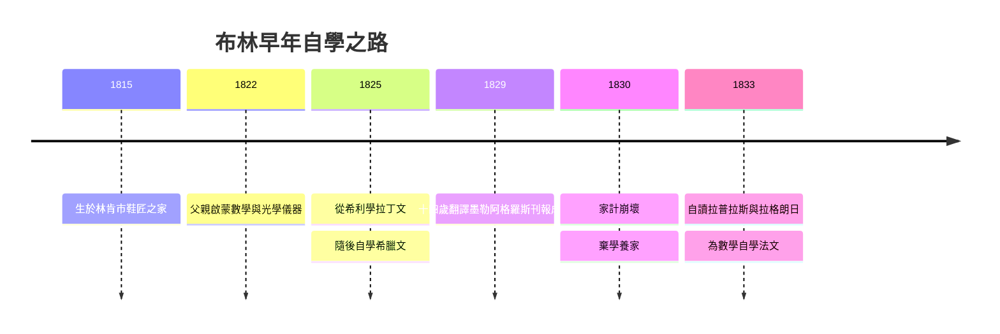

# 1.1 鞋匠之子與自學之路（1815–1833）

1815 年 11 月 2 日，喬治·布林（George Boole）出生於英格蘭林肯市（Lincoln）的銀街，父親約翰·布林是一名底層鞋匠，母親瑪麗·安·喬伊斯是女僕出身。這不是一個擁有書香傳統的家庭——父親唯一的「資產」，是對工具與小發明的業餘熱情：他自製望遠鏡、日晷，並把一架自製的觀測儀器掛在自家店鋪門口，成為林肯街頭的小小奇觀。

## 家貧而目光不貧

約翰·布林雖然是鞋匠，卻在兒子幼年時做出三件影響深遠的事：

- 親自教喬治基本的數學與光學知識，把店鋪當成小型實驗室；
- 認識了林肯的書商威廉·布魯克斯，透過這層關係，年幼的喬治得以接觸大量課外書籍；
- 在喬治約十歲時，安排他跟隨拉丁文教師威廉·希利學習拉丁文。

這三件事構成一條清晰的因果鏈：**鞋匠的動手文化 → 儀器與觀測 → 對「規則與結構」的早期敏感**。布林日後把邏輯變成「可運算的代數」，其思維原型正是在父親的工作檯上萌芽的——邏輯像齒輪一樣可以組裝。

## 自學的極限與超越

布林的學習速度驚人：六歲前由父親啟蒙算術，七歲半就能以希利的拉丁文教材自行推演，之後又靠文法書自學希臘文。十四歲時他公開翻譯了希臘詩人墨勒阿格羅斯（Meleager）的頌歌，刊於《林肯先驅報》（Lincoln Herald），卻引發一場小風波——當地校長質疑一個鞋匠之子不可能寫出這樣的譯文，引文對照之後，少年布林的才華反而得到公開確認。

但家庭的經濟崩壞在 1828 年前後到來：父親生意失敗，布林必須在十六歲前後就開始賺錢養家。**貧窮剝奪了他上大學的可能，卻也逼出了他最獨特的能力**——他從未受過任何正規的數學訓練，所有數學知識都來自自己啃讀原文書：

- 先讀 S. F. L'Hôpital 的《無窮小分析》（Analyse des infiniment petits）；
- 再讀克萊羅（Clairaut）、拉格朗日（Lagrange）、拉普拉斯（Laplace）的法文原典；
- 為了讀懂法文數學書，反而先自學法文，為了讀懂德文書又自學德文。

這段「先有問題、再為問題學語言」的順序，與學校教育完全相反，也塑造了布林終身的思維風格：**數學是一種可自足推理的結構，而不是需要導師傳授的技藝**。

## 為養家而教，為教而學

1831 年，十六歲的布林在唐卡斯特（Doncaster）的 Heigham 學校找到第一份助理教師工作。這份工作的因果意義極大：

1. 它把「養家壓力」轉化為「教學訓練」——為了教會學生，布林被迫把自學所得重新組織成可傳授的系統；
2. 唐卡斯特的圖書館讓他接觸到更廣的科學文獻；
3. 當地銀行家與牧師的圈子，成為他日後在林肯學術圈嶄露頭角的最初人脈。

1833 年他返回林肯，在自家附近的瓦靈頓（Waddington）一帶辦學，並加入林肯的「機械學會」（Mechanics' Institute）——這是父親當年儀器興趣的延伸：會所裡有藏書、有講座、有他可以發表演說的講台。

## 事件年表

| 年份 | 事件 | 後續影響 |
|---|---|---|
| 1815 | 生於林肯市鞋匠家庭 | 底層出身 ⇒ 無大學管道 ⇒ 自學成性 |
| 1822 前後 | 父親以儀器與算術啟蒙 | 「結構可組裝」的思維原型 |
| 1825 | 學拉丁文，後自學希臘文 | 直接閱讀原文的語言工具 |
| 1829 | 希臘文翻譯刊於《林肯先驅報》 | 地方學術圈首次認識布林 |
| 1830 前後 | 父親生意失敗 | 貧窮 ⇒ 提前就業 ⇒ 教師生涯 |
| 1831 | 赴唐卡斯特任助理教師 | 教學倒逼自學知識系統化 |
| 1833 | 返林肯辦學、加入機械學會 | 通向期刊發表的舞台 |

## 小結

布林的前十八年是典型的「被剝奪者的自學史」：大學之門關閉，反而讓他繞過了當時英國數學教育（以歐幾里得幾何為核心、輕視代數）的窠臼。他直接閱讀拉格朗日與拉普拉斯的分析傳統，養成了「代數可以像力學一樣普遍化」的直覺。這份直覺將在 1.2 中遇到第一個出口——新興的數學期刊，而期刊的最終回報，是 1.3 的皇后學院教授職位。貧窮是因，自學是路，期刊與講座是橋：一切才剛剛開始。
