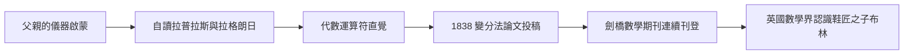

# 1.2 教師生涯與數學期刊（1833–1840）

如果說 1.1 的自學是「輸入」，那麼 1833–1840 這七年，就是布林學會「輸出」的關鍵期。一個無學位的鞋匠之子，如何擠進由劍橋、牛津畢業生壟斷的英國數學界？答案是：透過剛剛興起的數學期刊，與林肯本地的學術贊助網絡。

## 林肯文化圈：第一座橋

1833 年返回林肯後，布林的生活圍繞三個機構展開：

- **林肯機械學會**：父親的老據點。布林在此發表演講、閱讀新書，1838 年後更成為其精神領袖；
- **林肯第二大會堂早期教會（Early Closing Association）**：他為商店學徒開設夜間課程；
- **地方精英沙龍**：醫生、牧師與銀行家的家庭接待這位年輕教師，其中最重要者是林肯的爵士與後來成為劍橋數學教授的同行們。

這個網絡的直接效果：1840 年前後，布林的名字與譯作開始被送往更遠的地方，包括後來成為他重要通信者的**劍橋哲學會**（Cambridge Philosophical Society）。

## 教學之餘的數學衝刺

1835 年，布林在林肯自立門戶辦學校，把教學收入全部投入自學與購書。此時他讀到了改變他方向的兩類書：

1. 拉普拉斯《天體力學》與拉格朗日《分析力學》——確認了「普遍化的運算」可以解決具體物理問題；
2. 當時英國「分析學會」推廣的萊布尼茲–拉格朗日運算符傳統（$D$ 作為微分算子，$\dfrac{d}{dx}$ 可以像代數符號一樣被乘除）。

1838 年他首次投稿成功：一篇關於**變分法**的論文刊於《劍橋數學期刊》（Cambridge Mathematical Journal）。隔年他又發表了關於不變量理論先聲的代數研究。這些論文的特點極具個人印記——**它們都是「把運算符當成可以獨立操作的對象」的研究**，這正是他日後把「邏輯運算」也當成代數對象的方法論預演。

## 數學期刊：無學位者的合法戰場

維多利亞早期的英國，大學學位仍是數學界准入證。但 1830 年代的新事物改變了遊戲規則——《劍橋數學期刊》（1837 年創刊，後併入《劍橋與都柏林數學期刊》）接受「以論文品質而非出身取人」的投稿。對布林而言，這是決定性的制度變遷：

- **論文可以代替文憑**：1841 年起，他連續在期刊發表十餘篇論文，主題橫跨微分方程、變分法、概率論；
- **通信網絡自動生成**：編輯與讀者中包括鄧肯·格雷戈里（Duncan F. Gregory，《劍橋數學期刊》主編、「分析學會」成員）。格雷戈里成為布林的關鍵對話者，向他介紹了布爾漢式的「運算符代數」觀點；
- **跨海閱讀**：他同時追蹤法國與德國期刊，這在英國鄉間教師中極為罕見。

格雷戈里在 1839–1840 年間與布林的通信，特別值得注意：兩人反覆討論「**符號代數的哲學基礎**」——代數符號的意義是否可以與其運算規則分離？格雷戈里傾向認為可以，布林則走得更遠：他把這個觀點推向極端，認為**只要運算規則自洽，符號可以被賦予任何新的解釋**。這正是 1847 年《邏輯的數學分析》的種子。

## 概率論的轉折

1840 年前後，布林還在《機械學會雜誌》上發表過關於**概率與期望值**的短文。概率論對他日後的意義常被忽略：邏輯代數中的符號 $x$ 表示「類」（class），而 $x$ 的補集 $1-x$、聯集 $x+y$、交集 $xy$ 這套記號，與概率演算的結構完全同構。可以說，**沒有早年對概率論的練習，就沒有 1847 年那套乾淨的邏輯記號**。

## 事件年表

| 年份 | 事件 | 後續影響 |
|---|---|---|
| 1833 | 返林肯，加入機械學會 | 地方人脈與講台 |
| 1835 | 自立辦學 | 教學收入支撐自學 |
| 1838 | 首篇變分法論文獲刊 | 踏入期刊體系 |
| 1839–1840 | 與格雷戈里通信 | 「符號可與意義分離」的代數哲學 |
| 1840 前後 | 概率論短文 | 為邏輯代數記號埋下伏筆 |

## 小結

這七年的本質，是**制度縫隙裡的個人奮鬥**：辦學校解決生計，機械學會提供講台，期刊提供發表權，格雷戈里提供方法論啟發。四者互相驅動——講台鍛鍊了表達，期刊鍛鍊了寫作，通信鍛鍊了思想。到 1840 年，布林已經完成了從「自學者」到「被同行承認的數學家」的轉變。下一步，命運把一個更大的舞台送到林肯：愛爾蘭新成立的大學正在尋找不需要學位的數學教授——這將在 1.3 中登場。
