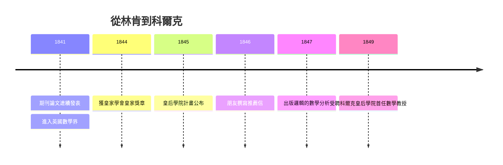

# 1.3 科爾克皇后學院教授（1840–1849）

1840 年代的布林完成了雙重躍升：在數學上，他從期刊作者成長為皇家學會成員；在人生上，他從林肯的窮教師變成愛爾蘭科爾克（Cork）皇后學院（Queen's College, Cork）的首任數學教授。但這個職位的取得過程，本身就是一場關於「才能 vs. 學位」的制度試驗。

## 皇后學院計畫：歷史的縫隙

1845 年，英國政府為解決愛爾蘭高等教育問題，決定在科爾克、戈爾韋（Galway）、貝爾法斯特（Belfast）三地設立「皇后學院」。這三所新學院的特點是：

- 宗教中立（不隸屬聖公會，也不隸屬天主教會）；
- 不要求教師持有牛津、劍橋學位——因為它們本來就要打破兩所老校的壟斷。

這條制度縫隙，正是為布林這種「無學位的數學家」量身打造的。1846 年起，林肯的朋友們（包括此前通信的劍橋學者與地方貴族）開始為他撰寫推薦信。1849 年，三十一歲的布林正式獲聘為科爾克皇后學院首任數學教授。此前 1844 年他已因微分算子研究獲**皇家學會皇家獎章**（Royal Medal），1847 年又出版了《邏輯的數學分析》——推薦人得以理直氣壯地說：此人雖無文憑，成就卻超過多數文憑持有者。

## 教授生涯的日常與矛盾

皇后學院 1849 年開學，布林的職責包括講授純數學與應用數學、擔任圖書館委員。他的教學口碑兩極：

- **優點**：他把最新的歐陸分析（拉普拉斯、拉格朗日傳統）直接帶進課堂，學生接觸到的是第一手的近代數學；
- **缺點**：他完全不懂得「因材施教」——按同事回憶，他對全班講解時，往往只為了「那可能存在的一兩個真有天賦的學生」而講，其餘學生如墜雲霧。

更深刻的矛盾是制度性的：皇后學院的薪俸微薄，布林仍須靠稿費與私人授課補貼，還要接濟年邁的雙親（他先後把父母接到科爾克）。**教授頭銜解決了身份問題，沒有解決經濟問題**——這解釋了他為何在 1850 年代仍拼命寫教科書（見 3.2）。

## 邏輯研究的爆發期

教授職位給了布林兩樣林肯給不了的東西：

1. **圖書館**：他得以系統閱讀邏輯學史——從亞里士多德、萊布尼茲到當代的漢密爾頓（William Hamilton）與德摩根（Augustus De Morgan）；
2. **論戰的距離**：1846–1847 年，漢密爾頓與德摩根為「量化謂詞」（quantification of the predicate）公開論戰。布林在林肯時期就被朋友建議「把邏輯變成數學」，此時已累積足夠準備。

1847 年冬，布林在極短時間內寫出《邏輯的數學分析》（The Mathematical Analysis of Logic）——他自述是「趁論戰熱度未消，搶在別人之前」完成的。這本 82 頁的小冊子，把亞里士多德的邏輯徹底代數化，是 2.1 的主角。因果鏈很清楚：

> 期刊時代的運算符直覺（1.2）→ 皇后學院的圖書館與漢密爾頓–德摩根論戰 → 1847 年小冊子 → 進一步擴寫為 1854 年《思維定律的研究》（2.2）。

## 事件年表

| 年份 | 事件 | 後續影響 |
|---|---|---|
| 1841 | 期刊論文持續發表 | 學術聲望累積 |
| 1844 | 獲皇家學會皇家獎章 | 推薦信的最硬憑證 |
| 1845 | 皇后學院計畫公布 | 制度縫隙打開 |
| 1846–1847 | 漢密爾頓–德摩根邏輯論戰 | 觸發布林投入邏輯代數 |
| 1847 | 《邏輯的數學分析》出版 | 邏輯代數誕生（詳 2.1） |
| 1849 | 受聘科爾克皇后學院教授 | 階級躍升與研究資源到位 |

## 小結

1849 年的任命，是一場「多方合力」的勝利：皇家獎章提供了實力證明，皇后學院的宗教中立政策提供了制度空間，林肯人脈提供了推薦信。而這個職位又立刻反饋給研究——圖書館與論戰催生了《邏輯的數學分析》。值得注意的是，布林到科爾克時已是成名的分析學家，邏輯代數只是他的「第二事業」；他的第一事業（微分方程與運算符）將在 3.2 以教科書的形式收尾。下一章，我們正式進入《邏輯的數學分析》的內部。
