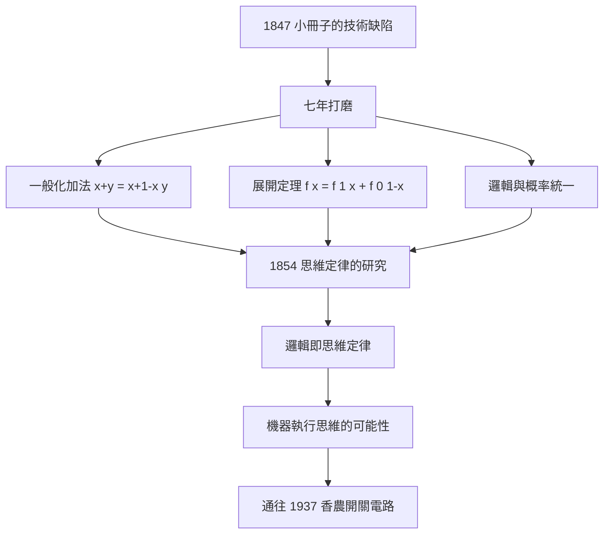

# 2.2 思維定律的研究（1854）

1854 年，布林在倫敦出版了《思維定律的研究，作為邏輯與概率的數學理論之基礎》（An Investigation of the Laws of Thought, on Which Are Founded the Mathematical Theories of Logic and Probabilities）。這是他一生最重要的著作——1847 年小冊子是「搶時機的宣言」，1854 年巨著則是「集大成的體系」。

## 七年打磨：為何重寫

1847 年之後，布林並沒有乘勝追擊、連續發表。相反，他把邏輯研究雪藏了七年。原因有三：

1. **技術缺陷**：小冊子中 $x+y$ 要求 $x$、$y$ 互斥，展開選言推理時經常需要人工「排除」非互斥情形，系統不夠機械化；
2. **哲學野心**：他不滿足於「另一種邏輯記法」，想回答更大的問題——**思維本身的定律是什麼？邏輯與概率為何同構？**；
3. **生活的擠壓**：科爾克教職薪俸微薄，他要教課、寫微分方程教科書（見 3.2）、照顧父母，巨著只能夜裡寫。

這個「七年」的意義在於：布林真正做出了**把邏輯、概率、心智哲學縫合成一個體系**的嘗試，而不是發明一套速記符號。

## 系統的完備化

《思維定律的研究》對 1847 年系統的三項關鍵修正與擴充：

### 一、一般化的加法

引入可分離的並集記號：當 $x$、$y$ 不互斥時，改寫

$$x + y = x + (1-x)y,$$

即「$x$ 或 $y$」=「$x$ 或（非 $x$ 且 $y$）」。用今天的語言，這就是

$$x \lor y = x \lor (\lnot x \land y),$$

——與現代布爾代數的標準恆等式完全一致。邏輯推理從此**不再需要人工排除重疊**，可以純機械地展開。

### 二、展開定理（Expansion Theorem）

布林證明：任何邏輯函數 $f(x)$ 都可展開為

$$f(x) = f(1)\cdot x + f(0)\cdot(1-x),$$

二元情形則有十六項的完全展開。這在當代視角下，正是**真值表的解析形式**：$f(1)$、$f(0)$ 就是函數在兩種賦值下的取值。布林等於提前一百年寫出了數位電路設計的數學基礎（詳見 5.1）。

### 三、邏輯與概率的統一

全書最大的野心在後半部：設命題 $x$ 為真之概率為 $p$，則

$$P(x \land y \mid x) = \cdots$$

布林把邏輯代數直接用作**概率論的骨架**——同一套符號 $x, y, 1-x, xy$，在邏輯中表「類」，在概率中表「事件的指示函數」。這一統一，使《思維定律的研究》同時成為邏輯代數與概率演算兩門學科的奠基文獻。

## 「思維定律」的哲學主張

書名中的「思維定律」不是修辭。布林在前言中主張：邏輯運算所依循的定律，**同時是人類心智進行推理的實際定律**——代數不只是記法，而是對思維結構的描述。這一主張沿襲萊布尼茲的「普遍文字」（characteristica universalis）夢想，也呼應了當時的心理學轉向。它在哲學上引發百年爭論（羅素與弗雷格後來都拒絕「邏輯即心理學」，詳見 4.2 與《弗雷格傳記》），但在工程上被證明意義深遠：**只要定律成立，機器就能執行思維**。

## 同時代的回聲

1854 年前後，布林的思想已有零星回應：耶方斯（W. S. Jevons）在 1850 年代末讀到此書，聲稱是「一生中最受啟發的閱讀」；德摩根則在書評中給予高度肯定。但總體而言，這本書在布林生前**銷量平平、讀者寥寥**——它太數學化，哲學家讀不懂；太哲學化，數學家覺得不務正業。它的黃金時代要等到布林死後，由耶方斯、皮爾士、施羅德接力開掘（詳見第 4 章）。

## 事件年表

| 年份 | 事件 | 後續影響 |
|---|---|---|
| 1847 | 小冊子出版但技術粗糙 | 種下重寫動機 |
| 1848–1853 | 夜間斷續寫作 | 教職與家庭擠壓進度 |
| 1854 | 《思維定律的研究》出版 | 邏輯代數體系完備 |
| 1850 年代末 | 耶方斯閱讀並深受震撼 | 傳播接力開始（詳 4.1） |

## 小結

《思維定律的研究》把 1847 年的宣言升級為體系：一般化加法解決了互斥困境，展開定理預言了真值表，邏輯–概率同構打通了兩門學科。「思維定律」的哲學主張使它同時觸怒兩個學界，卻也使它成為跨越哲學、數學、工程三個世紀的源頭文本。可惜布林本人沒有等到讀者——他於 1864 年去世（詳見 3.3），屍解其思想的接力棒，交給了耶方斯與皮爾士。
