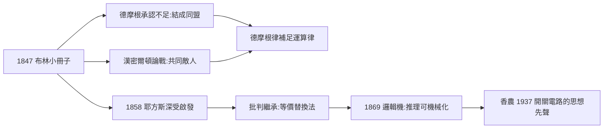

# 2.3 與德摩根和耶方斯的互動（1847–1864）

布林並非孤島。從 1847 年到 1864 年去世，他的邏輯事業始終在三組通信與論戰中成形：與德摩根的**同盟**，與耶方斯的**啟蒙–繼承**，以及與漢密爾頓的**敵對**。正是這些互動，決定了布爾代數生前的形態與死後的傳播路線。

## 德摩根：同路人的惺惺相惜

1847 年《邏輯的數學分析》出版後，倫敦大學教授德摩根（Augustus De Morgan, 1806–1871）立刻寫信給布林，坦承自己的《形式邏輯》在數學化程度上不及布林。此後直至布林去世，兩人維持了十七年的通信。這段友誼的實質內容：

- **對稱的互補**：德摩根貢獻了著名的**德摩根律**

$$\overline{x \land y} = \bar{x} \lor \bar{y}, \qquad \overline{x \lor y} = \bar{x} \land \bar{y},$$

布林則貢獻了把整個邏輯變成方程系統的框架。兩人誰也沒有「包含」誰——這是雙軌並進的兄弟系統；
- **家族紐帶**：布林的妻子 Mary Everest Boole 與德摩根一家交好，德摩根成為布林家的常客與私人顧問（布林晚年拒絕了德摩根與數學家赫歇爾爵士聯名寫給政府的薦職信，理由是「不願以私誼求官職」）；
- **論戰的緩衝**：在與漢密爾頓的論戰中，德摩根與布林立場相近，兩人形成了對蘇格蘭哲學家陣營的「數學側翼」。

## 耶方斯：從讀者到改良者

耶方斯（William Stanley Jevons, 1835–1882）自述在 1858 年前後閱讀《思維定律的研究》是「改變一生」的經驗。但他對布林的態度是**批判性繼承**：

- 他承認布林的代數化方向正確；
- 卻反對其「機械展開方程」的方法——布林的方法計算冗長，耶方斯主張用他自己的**等價替換法**（substitution of similars），推理是「把相似的東西互相替換」；
- 1860 年代兩人通信爭論方法論，布林去世前（1863 年前後）仍與耶方斯有直接書信往來，且態度是勉勵而非否定。

耶方斯後來建造了世界上第一台**邏輯機**（logical piano, 1869），能機械地完成三段論推理——這台機器是布林「邏輯可計算」主張的第一具物理證據，也是香農開關電路（4.3）的精神先祖。

## 漢密爾頓：不承認的敵人

蘇格蘭哲學家漢密爾頓爵士（William Hamilton, 1788–1856）是論戰的另一方，但他從未與布林直接交流，並且對布林抱有輕蔑——他稱數學家談邏輯是「越界」，甚至說布林「既不是形上學家也不是邏輯學家」。這個敵對關係的客觀效果卻是正面的：

- 論戰迫使布林把立場寫得極端清晰；
- 漢密爾頓陣營的攻擊（「數學不能處理質」）反而凸顯了布林系統的激進性——**邏輯的「質」正是可以被量化的**。

## 通信網絡的整體圖景

把三組關係放在一起，可以看到布林學術生命的結構：

| 對象 | 關係性質 | 貢獻/衝擊 | 後續 |
|---|---|---|---|
| 德摩根 | 同盟 | 德摩根律；持續肯定 | 與布林家族世交 |
| 耶方斯 | 啟蒙–繼承 | 簡化方法；造邏輯機 | 成為傳播第一棒（4.1） |
| 漢密爾頓 | 敵對 | 論戰壓力 | 客觀上放大布林聲量 |

## 小結

布林的互動網絡揭示了一個規律：**同盟提供補全，繼承者提供傳播，敵人提供舞台**。德摩根的德摩根律使系統對稱完備；耶方斯的批判使方法簡化並終於機械化；漢密爾頓的攻擊使新思想獲得曝光。布林生前沒有形成學派，但他身後的每一棒傳人——耶方斯、皮爾士、施羅德、羅素、香農——都站在這個網絡延長線上（詳見第 4 章）。而他個人的生命故事，則在第 3 章轉入家庭與晚年的溫情與悲劇。
