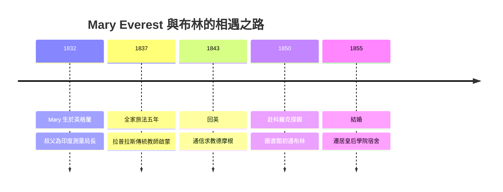

# 3.1 與 Mary Everest Boole 的婚姻（1855）

1855 年，三十九歲的布林做出了科爾克同事眼中「不經濟」的決定：與二十三歲的瑪麗·艾弗勒斯（Mary Everest, 1832–1916）結婚。這段婚姻只有九年（布林 1864 年去世），卻是數學史上最有生產力的知識夥伴關係之一——Mary 後來成為數學教育先驅，五個女兒中三人成為知名學者，其中的化學家與幾何學家各領一個時代。

## 相遇：從林肯到科爾克的知識鍊

兩人的相遇是一條跨國、跨階級的因果鏈：

1. Mary 的叔父喬治·艾弗勒斯爵士（Sir George Everest）是印度測量局局長，珠穆朗瑪峰（Mount Everest）即以他命名；
2. 1837 年後，她的父親牧師 Thomas Everest 因病赴法國療養，全家旅居法國五年；
3. 在法國，女孩的數學教師是**德比烏內（M. DebUNNE，拉普拉斯傳統的私塾教師）**，Mary 因此接受了遠超同時代女性的數學訓練；
4. 1843 年回英後，Mary 與布林的友人德摩根相識，德摩根成為她非正式的數學通信導師——**德摩根是連接兩人的第一環**；
5. 1850 年，Mary 赴科爾克探望叔父（時任皇后學院副校長的艾弗勒斯家族親戚），在圖書館初次遇見布林。

## 婚姻的知識結構

這不是傳統意義的「教授娶妻」，而是兩個自學者（兩人皆無大學學位）的合夥。婚後九年的分工與互動：

- **Mary 參與校對與繕寫**布林的《差分方程論》（見 3.2）與邏輯手稿，她自述「我讀他的手稿，標出讀不懂的地方，他重寫」——這是最早的「同行評審式伴侶協作」；
- **兩人共讀哲學**：Mary 對心理學與教育的興趣（深受法國理性主義教育觀影響），與布林「思維定律」的哲學野心互相餵養；
- **經濟上的坦誠**：婚後生活清苦（教授薪俸微薄），Mary 主動承擔理家與私人授課的安排，使布林能維持夜間寫作。

Mary 後來回憶，兩人約定「永遠不為錢爭吵，因為錢的問題沒有解」。這句玩笑話背後，是對「思想生活需要制度保護」的共同信念。

## 子女：一個知識王朝的誕生

1856–1864 年間，兩人生育了五個女兒，日後各成一門學科的先驅：

| 女兒 | 生卒 | 成就 |
|---|---|---|
| Mary Ellen | 1856–1908 | 數學家，與數學家 Charles Hinton 成婚（Hinton 家族為四維幾何先驅） |
| Margaret | 1858–1935 | 與畫家 Edward Ingram Taylor 成婚（其子 G. I. Taylor 為流體力學大師） |
| Alicia | 1860–1940 | **四維以上多胞形（polytopes）幾何的自學權威** |
| Lucy | 1862–1904 | 英國**第一位化學女教授**（倫敦藥學院） |
| Ethel Lilian | 1864–1960 | 小說《牛虻》（The Gadfly）作者，革命文學經典 |

最小的女兒 Ethel 出生於布林去世前五個月——婚姻以死亡收尾，卻以一個橫跨數學、化學、文學的家庭延續了一百多年。這是 3.3 的伏筆，也是布林傳記最動人的後代註腳。

## 小結

1855 年的婚姻，把布林的私人生活與知識生活焊接在一起：Mary 帶來了法國分析傳統的教養、對教育與心理學的長期關注，以及一個後來輝煌的家庭。反過來，布林的「思維定律」哲學直接塑造了 Mary 日後的教育理論（她主張數學應從「實物操作」學起，是 Montessori 之前的重要聲音）。婚姻帶來的最後一項「產出」，是 1859 年的《差分方程論》——那是布林應用數學事業的頂點，也是 3.2 的主題。
