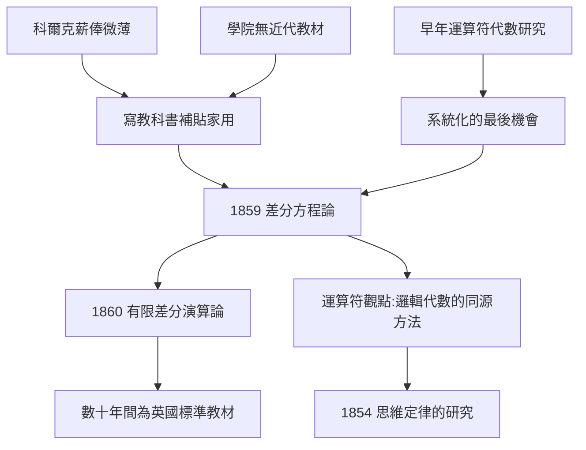

# 3.2 微分方程教科書與教育影響（1859–1860）

1859–1860 年，布林出版了兩部教科書：《差分方程論》（A Treatise on Differential Equations, 1859）與《有限差分演算論》（A Treatise on the Calculus of Finite Differences, 1860）。這兩本書長期被布爾代數的光環遮蔽，但對布林本人而言，它們才是他「第一事業」（分析數學）的總結，也是科爾克教職真正的經濟支柱，更是十九世紀後半英國數學教育的實際標準教材。

## 為何寫教科書：三重因果

布林的教科書寫作不是附屬品，而是三股壓力的直接產物：

1. **經濟壓力**：皇后學院教授年薪僅約 £250，還須供養父母與日益龐大的家庭（婚後女兒相繼出生）；
2. **教學壓力**：皇后學院缺乏合用的近代分析教材，布林被迫自編講義——講義長成教科書是自然演化；
3. **方法論回歸**：他早年（1838–1844）成名於微分算子與變分法，寫教科書是把「運算符代數」系統化的最後機會——**寫教科書的過程，其實與寫《思維定律的研究》共享同一個方法論內核**。

## 《差分方程論》：運算符的凱旋

《差分方程論》的獨特之處在於**以算子 $D$ 為主角**：把 $\dfrac{d}{dx}$ 記作 $D$，把差分算子記作 $\Delta$，然後用純代數手法操縱它們。典型手法是利用指數位移定理

$$e^{-hD} f(x) = f(x-h),$$

把微分方程轉換為差分方程，或把兩者統一處理。書中還收入了日後稱為 **Boole 收斂判別法**（Boole's rule，數值積分的梯形推廣公式）等結果。

這本書的深遠影響有三：

- **教材標準**：此後半個多世紀，它是英國與印度大學的標準教科書（直到二十世紀初仍在重印）；
- **印度數學的橋樑**：拉馬努金（Srinivasa Ramanujan）在馬德拉斯自學時啃讀的正是布林的著作之一——**布林的自學教材培養了下一個自學天才**；
- **方法論示範**：「把算子當代數對象」的寫法，與《思維定律的研究》把「邏輯詞當代數對象」完全同構。兩本書是同一個頭腦的兩面。

## 《有限差分演算論》與離散數學的先聲

1860 年的《有限差分演算論》處理離散對象的演算——差分、求和、生成函數。今天回看，這正是**離散數學**（電腦科學的數學基礎）的先聲。布林在此書中再次展示了他一貫的信念：

> **連續與離散、數與邏輯，都服從更深一層的符號運算定律。**

## 「教育影響」的另一面：Mary 與女兒們

布林的教育影響不限於教科書。1855 年婚後，他與 Mary 形成了一套家庭教育實踐：

- 女兒們從小操作實物學數學（Mary 後來總結為「用豆子與積木學算術」）；
- Alicia 在父親去世後自學多維幾何，自述方法來自「父親留下的思維習慣——先設符號，再讓符號自己說話」；
- Mary 晚年寫出《符號邏輯的哲學與樂趣》（The Philosophy and Fun of Algebra, 1909），把布林的代數觀轉譯為兒童教育讀物。

換言之：**布林的教科書影響了課堂，布林的家庭教育影響了女兒，女兒們又各自影響了幾何、化學與文學**——這是一條遠比「一篇論文」更長的影響鏈。

## 事件年表

| 年份 | 事件 | 後續影響 |
|---|---|---|
| 1855 | 婚後經濟壓力上升 | 教科書寫作的直接動機 |
| 1859 | 《差分方程論》出版 | 英國數十年標準教材 |
| 1860 | 《有限差分演算論》出版 | 離散數學先聲 |
| 1900 前後 | 拉馬努金自學布林教科書 | 影響延伸至印度數學（另見《拉馬努金》相關主題） |

## 小結

1859–1860 年的兩部教科書，是布林「第一事業」的紀念碑：它們把運算符代數寫成了可傳承的課本，養育了兩代英國（與印度）數學學生。它們與《思維定律的研究》共享同一個方法論——**符號一旦被賦予規則，就能自己走完全程**。教科書的稿費支撐了家庭，家庭的知識氛圍又反哺了邏輯與教育。然而這條生產線在 1864 年被一場雨澆斷——下一節，我們面對布林的死亡。
