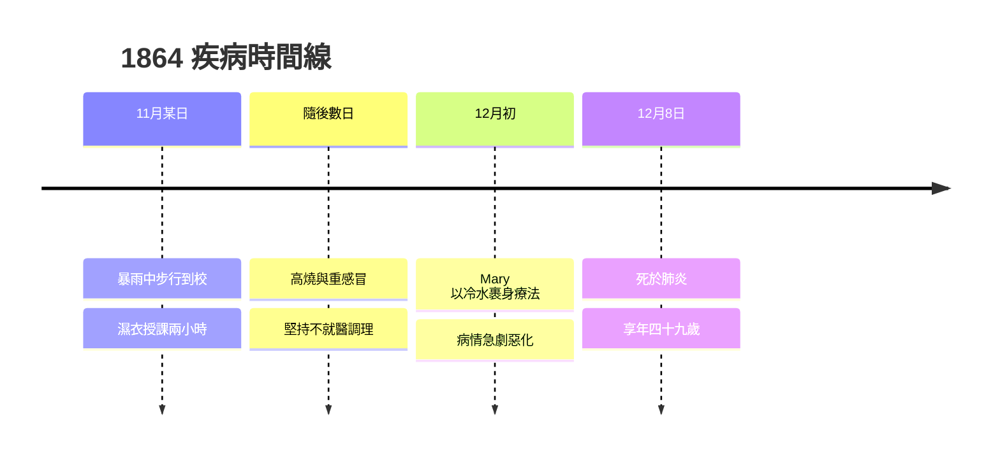

# 3.3 肺炎與去世（1864）

1864 年 12 月 8 日，布林在科爾克去世，享年四十九歲。死因是一場看似微不足道的淋雨，以及一段今天讀來令人痛心的「治療史」。這個結局與他一生的理性主義信念形成了殘酷的對照，也直接引發了邏輯代數「群龍無首」的傳播史（第 4 章）。

## 疾病的全過程

1864 年 11 月，布林從住處步行三英里到皇后學院上課。當天暴雨傾盆，他渾身濕透仍堅持**穿著濕衣講完兩小時的課**，隨後又步行回家。此事有兩種解讀，各有因果意義：

1. **階級記憶說**：自幼貧寒的布林習慣了「身體不算什麼」，濕衣上課是他一生苦行的延續；
2. **責任倫理說**：他認為臨時取消課程是對學生失信。

回家後他得了重感冒，繼而高燒不退。妻子 Mary 深信當時流行的一種民間療法——「**病從何來，就置於何**」：既然病由淋雨而生，就用冰水裹身「歸還」疾病。她將丈夫用冷水浸泡的床單裹住，放在床墊之下。病情急轉直下，最終診斷為**肺炎（胸腔積水）**，十二月八日不治。

## 死亡的連鎖後果

布林的猝逝在學術史上造成了一個真空，其後果遠超一般人的想象：

- **《思維定律的研究》沒有捍衛者**：布林生前系統尚有粗糙處（如 $x+y$ 的用法、方程的「解」何時有效），死後無人能以作者權威裁決爭議；
- **傳播責任外溢**：耶方斯在 1864 年後接過解釋權（4.1），皮爾士與施羅德接力，形成「**三國演義式**」的傳播鏈（英國–美國–德國）；
- **家庭轉入困境**：Mary 帶著五個女兒（最小的 Ethel 出生僅五個月）失去收入來源。她靠私人授課、寫作與朋友（包括德摩根與赫歇爾家族）接濟度日，後來反而在數學教育領域自成一家——**悲劇變成了另一條生產線**；
- **遺稿的守護**：Mary 保存並整理了布林的邏輯手稿與通信，使後世（包括 4.2 的施羅德與羅素一代）得以追蹤原始思路。

## 身後的榮耀與安息

布林葬於科爾克的 St Michael 教堂墓地。1900 年前後，科爾克大學（今 University College Cork）以他的名字命名圖書館與數學樓；1995 年該校設立**布林中心**（Boole Centre）；2015 年（誕辰二百週年）愛爾蘭舉行全國性紀念，NUI 榮譽學位追授、紀念幣發行，Google 亦以 Doodle 致敬。一個無學位的林肯鞋匠之子，死後成為愛爾蘭的國家紀念對象。

## 事件年表

| 年份 | 事件 | 後續影響 |
|---|---|---|
| 1864.11 | 暴雨中濕衣授課 | 疾病起點 |
| 1864.12 初 | 冷水療法誤治 | 病情惡化 |
| 1864.12.8 | 逝世 | 邏輯代數失去作者權威 |
| 1864 之後 | Mary 守護遺稿 | 為傳播史保留一手文獻 |
| 1869 | 耶方斯造出邏輯機 | 傳播接力第一棒（4.1） |

## 小結

布林的死是「理性主義者的非理性死亡」——一場可以用常識避免的悲劇。但歷史的弔詭在於：**作者的死亡反而加速了思想的傳播**。沒有權威的系統被迫接受公共檢驗與改良，耶方斯、皮爾士、施羅德各自的手術刀使布爾代數從「天才的草稿」變成「公共的學科」。從這個意義上說，1864 年 12 月 8 日是布爾代數「成年禮」的起點——下一章，我們跟隨這根接力棒走過七十年。
