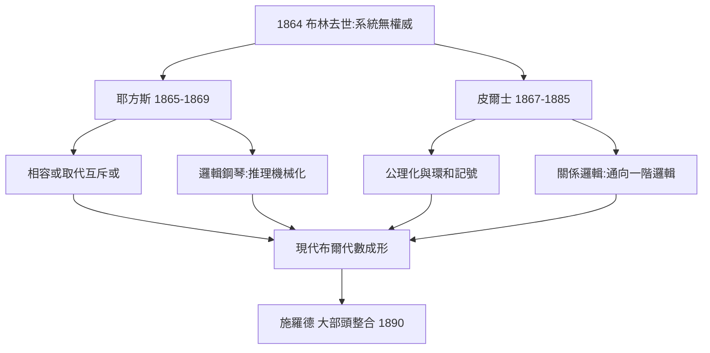

# 4.1 耶方斯與皮爾士的修正（1865–1880）

布林 1864 年去世後，布爾代數進入「修正時代」。英國的耶方斯與美國的皮爾士在 1865–1880 年間對系統動了兩次關鍵手術：一次簡化了邏輯推演的**方法**，一次放寬了邏輯運算的**律則**。沒有這兩次手術，就沒有今日我們熟悉的布爾代數 $x \lor y = y \lor x$、$x + y + z$ 任意並用等形式。

## 耶方斯：從方程消去到等價替換

耶方斯（William Stanley Jevons, 1835–1882）在 1864 年出版《純邏輯》（Pure Logic），公開批評布林的方法：

- **布林的缺點**：推演依賴解方程與展開定理，過程冗長，且中間符號常失去邏輯可讀性；
- **耶方斯的方案**：**等價替換**（substitution of similars）——推理就是「把命題中相同的成分互相替換」，如由 $A = B$ 可在任何出現 $A$ 處換成 $B$；
- **關鍵放寬**：耶方斯把布林的「互斥或」$x+y$ 改為**相容或**（inclusive or），即今日的 $x \lor y$。他稱之為「最有生產力的一步」。

耶方斯並不滿足於紙面：1869 年他建造了**邏輯鋼琴**（Logical Piano）——一台木箱狀的機械，能自動完成三段論推理，並在 1876 年於倫敦的儀器展上公開演示。這是「思維定律」第一次物理化：**布林說思維可以計算，耶方斯讓機器真的算給你看**。→ 機器執行邏輯的下一步，詳見《香農傳記》第 2 章。

## 皮爾士：布爾代數的「現代化手術」

美國哲學家皮爾士（Charles Sanders Peirce, 1839–1914）及其學生米切爾（O. H. Mitchell）在 1867–1885 年間完成了更徹底的修正：

1. **1867 年**：皮爾士在《論一個新穎的布爾邏輯演算擴充》中引入**未定義項與公理化**的寫法，把布爾系統整理為少量律則 + 推論規則的形式；
2. **異或的嚴格化**：皮爾士明確區分**並集** $x + y$（相容或）與**環和** $x + y - 2xy$（異或），解決了布林系統最大的含混；
3. **1880–1885 年**：引入**關係邏輯**（logic of relatives），把布爾代數從「類的代數」擴充為「關係的代數」——這一步直通現代一階邏輯，也深刻影響了施羅德（4.2）。

皮爾士還有一個常被忽略的貢獻：他在 1880 年的論文中給出了用 $\lnot$ 與 $\lor$ 定義所有連接詞的完備性觀察，即今日所謂**函數完備性**（functionally complete）思想的先聲——這正是後世數位電路「只用 NAND 閘即可建造一切電路」的理論根據（5.1）。

## 英美雙線的獨立與合流

值得注意的歷史細節：耶方斯與皮爾士**幾乎獨立工作**（皮爾士 1867 年論文發表前並不知道耶方斯的《純邏輯》），兩人卻在同一點上碰頭——**相容或**。這是邏輯史上的趨同演化：只要認真操作布林的系統，就必然發現互斥或的不便。此後英、美兩線在期刊上互相引證、互相批評，形成了布爾代數的第一個「國際學科共同體」。德國的施羅德隨後加入，成為第三極（4.2）。

## 事件年表

| 年份 | 事件 | 後續影響 |
|---|---|---|
| 1865 | 耶方斯《純邏輯》 | 等價替換法確立 |
| 1867 | 皮爾士首篇邏輯論文 | 公理化開端 |
| 1869 | 耶方斯邏輯鋼琴 | 推理機械化的實物證明 |
| 1870s | 相容或成為共識 | 現代 $x \lor y$ 記法確立 |
| 1880–1885 | 皮爾士關係邏輯 | 通向一階邏輯與施羅德體系 |

## 小結

1865–1880 年的兩次修正有明確分工：**耶方斯改方法（更快、更可機械化），皮爾士改架構（更嚴格、更普遍）**。修正後的布爾代數已經非常接近今日課本裡的模樣：相容或、環和、公理清單、關係擴充。而這個成形後的系統，正好趕上一個更大的歷史機遇——德國學派的系統化整理與《數學原理》的集大成（4.2），以及最終在電路中的化身（4.3）。
