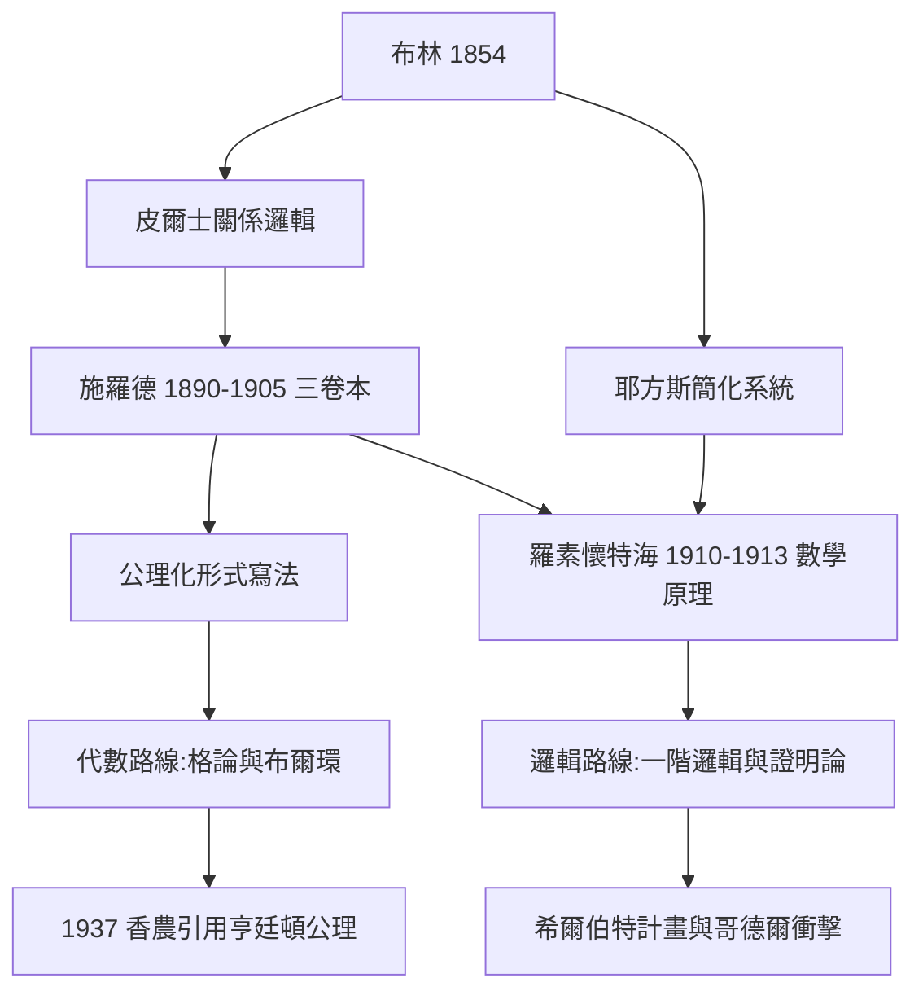

# 4.2 Schröder 與羅素懷特海的吸收（1890–1910）

1890–1910 年是布爾代數的「經典化時代」。德國的施羅德（Ernst Schröder, 1841–1902）以三卷本巨著把布林–皮爾士傳統整理成嚴格體系；英國的羅素與懷特海則在《數學原理》（Principia Mathematica, 1910–1913）中把邏輯推向新的高度。耐人尋味的是：**《數學原理》既繼承了布爾代數的遺產，又刻意與它拉開距離**——這段「吸收與分岔」的歷史，決定了二十世紀邏輯的兩條路線。

## 施羅德：《邏輯代數講義》的集大成

施羅德的《邏輯代數講義》（Vorlesungen über die Algebra der Logik，三卷，1890–1905）是十九世紀布爾傳統的總結：

- **第一卷（1890）**：命題邏輯與類演算的公理化，包括著名的**施羅德–伯恩斯坦定理**（Schröder–Bernstein theorem）——若 $A$ 與 $B$ 互為對方的子集之像，則 $A \sim B$，此定理後來由伯恩斯坦獨立重證並以兩人命名，成為集合論基石；
- **第二卷（1891）**：詳盡闡述皮爾士的**關係邏輯**，發展了關係的並、交、逆、複合等運算；
- **第三卷（1895）**：關係代數的代數結構。

施羅德的寫法有一個影響深遠的特點：**把他律式（identities）與推論規則分開，把演算寫成「公理 + 變形規則」的現代形式**。這使布爾傳統從「聰明的計算技巧」升級為「可公理化的代數結構」——正是這種寫法，讓三十年後的電機工程師能夠直接引用布爾代數的「定律清單」（5.1）。

## 羅素與懷特海：繼承中的分岔

→ 布林對羅素一代的影響背景，可先參考《羅素傳記》第 1 章與 2.3 節（摩爾與羅素叛離黑格爾）。

羅素（Bertrand Russell）在 1900 年之前讀過皮爾士與施羅德，1900 年 7 月參加巴黎國際哲學會議聽了皮亞諾（Peano）的報告後，轉向皮亞諾–弗雷格符號系統。1900–1913 年與懷特海合著《數學原理》，其結果對布爾代數是「吸收而後超越」：

1. **吸收的部分**：《數學原理》第一部分同樣從命題邏輯與類演算出發，其基本律則（如 $p \lor p \supset p$）與布爾傳統共享血統；羅素明確承認布林與施羅德是「符號邏輯的兩大先驅」；
2. **分岔的部分**：羅素–懷特海採用**實質蘊涵 $\supset$ 與量詞**作為原生裝置，而不是布林的類方程；他們把「思維定律」的心理學外衣徹底剝掉——邏輯是**獨立於心智的形式系統**。這一立場上承弗雷格的反心理主義（→ 詳見《弗雷格傳記》），下接希爾伯特的證明論計畫（→ 詳見《希爾伯特傳記》）；
3. **排除的部分**：《數學原理》幾乎不討論「邏輯即代數」的觀點，布爾代數在主流數理邏輯敘事中退居「布爾環 / 格論」的代數分支。

## 亨廷頓公理：兩條路線的橋樑

1904 年，美國數學家亨廷頓（E. V. Huntington）發表《一組獨立的布爾代數基本公理》（Sets of Independent Postulates for the Algebra of Logic），為布爾代數給出**極簡獨立公理組**（以 $+$、$\cdot$、$'$ 三運算為基礎，如結合律、交換律、以及

$$x + x' = 1, \qquad x \cdot x' = 0$$

這對互補律）。這組公理是「代數路線」的精煉成果，而它將在 1937 年被香農直接引用，成為把邏輯搬進電路的契約文本（4.3）。代數路線看似與《數學原理》分道揚鑣，實則在香農手中殊途同歸。

## 事件年表

| 年份 | 事件 | 後續影響 |
|---|---|---|
| 1890 | 施羅德第一卷出版 | 布爾傳統公理化 |
| 1891 | 第二卷（關係邏輯） | 關係代數成形 |
| 1900 | 羅素轉向皮亞諾符號 | 《數學原理》路線確立（見《羅素傳記》2.1） |
| 1904 | 亨廷頓獨立公理組 | 香農引用的文本準備 |
| 1910–1913 | 《數學原理》三卷 | 主流邏輯與布爾代數分岔 |

## 小結

1890–1910 年的關鍵詞是「**經典化與分岔**」：施羅德把布林傳統鑄成公理化的鋼模，羅素–懷特海把邏輯帶向量詞與證明論的高原。布爾代數在主流敘事中退場，卻在亨廷頓的公理清單中待命。歷史的安排極具戲劇性——十年後，一位 MIT 的碩士生在圖書館裡同時讀到《數學原理》與電話交換機的電路圖，把兩條路線重新焊在一起。這就是 4.3 的香農。
