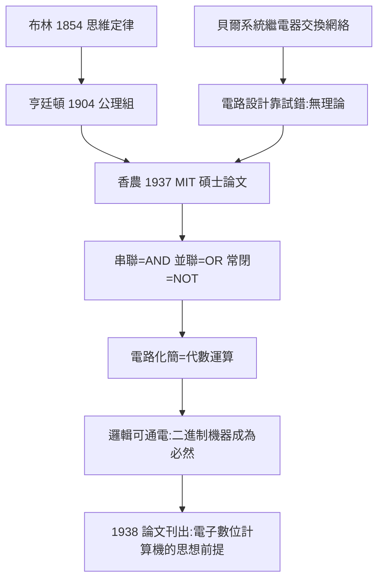

# 4.3 香農開關電路論文（1937）

1937 年，二十一歲的克勞德·香農（Claude Shannon）在 MIT 寫出碩士論文《繼電器與開關電路的符號分析》（A Symbolic Analysis of Relay and Switching Circuits, 1938 年發表於 Transactions of the AIEE）。這篇論文做了一件十九世紀以來無人完成的事：**把布爾代數與實際電路一對一地焊接起來**——邏輯從此不僅可以被計算，還可以被通電。這是布林思想史上最重要的一次「異地重逢」。

## 兩份文本的相遇

香農的出發點是兩份看似無關的文本：

1. **亨廷頓 1904 年的布爾代數公理**（4.2）：交換律、結合律、分配律、互補律 $x + x' = 1$、$x \cdot x' = 0$；
2. **貝爾實驗室的電話交換系統**：當時長途電話網依賴機電繼電器（relay）組成的龐大交換電路，電路設計全靠工程師經驗與試錯，沒有系統方法。

香農在 MIT 佈線實驗室（負責維護 Bush 的微分分析儀——一台用繼電器做控制的機械計算機）工作時察覺：**繼電器的通斷狀態，恰好是一個只取兩個值的變數**。若令

$$x = 1 \ (\text{觸點閉合}), \qquad x = 0 \ (\text{觸點斷開}),$$

則串聯就是 $\land$（記作乘 $xy$），並聯就是 $\lor$（記作加 $x+y$），常閉觸點就是 $\lnot$（記作 $x'$）。亨廷頓公理組逐一被電路實現：串並聯的先後組合滿足交換律與結合律，分配律

$$x(y + z) = xy + xz$$

對應「串聯（並聯）」的電路化簡，互補律對應常開與常閉觸點的組合。**每一條代數恆等式，都是一條電路化簡規則**——布爾代數成了開關電路的微積分。

## 論文的三層貢獻

1. **對應定理**：證明繼電器電路類與布爾代數表達式之間存在一一對應，且電路的行為完全由表達式的恆等變換決定；
2. **化簡方法**：給出用代數恆等式（如 $x + xy = x$——吸收律）化簡電路、減少繼電器數量的系統方法，直接降低成本與故障率；
3. **設計綱領**：指出更複雜的計算（加法器、比較器、選擇器）都可由這些基本閘組合——**這是「通用數位計算機」的電路藍圖**。香農在論文中甚至演示了一個用繼電器搭的二進制加法器。

→ 香農個人的生平脈絡（如 1948 年資訊論），詳見《香農傳記》第 2 章與 3.1 節。

## 為什麼是 1937：多重條件的匯合

這一「重逢」並非偶然，而是多重條件在同一年匯合：

| 條件 | 提供者 | 作用 |
|---|---|---|
| 代數工具 | 布林 1854 → 亨廷頓 1904 | 給出可引用的公理與恆等式 |
| 硬體需求 | 貝爾系統繼電器網絡 | 給出真實的工程痛點 |
| 二進制直覺 | 白土（Whitehead）–羅素傳統的符號訓練 + MIT 計算機實務 | 讓香農能同時讀懂兩邊 |
| 制度機會 | MIT 碩士論文制度 | 讓跨界想法有合法出口 |

值得注意的是：耶方斯 1869 年的邏輯鋼琴（4.1）已經機械化了推理，但它**只做邏輯題**；香農的突破在於把方向反轉——**用邏輯去設計任意機器**。邏輯不再是被執行的對象，而是設計語言。

## 事件年表

| 年份 | 事件 | 後續影響 |
|---|---|---|
| 1904 | 亨廷頓公理組 | 提供可引用文本 |
| 1930s | 貝爾繼電器交換網擴張 | 工程痛點成熟 |
| 1937 | 香農完成 MIT 碩士論文 | 邏輯與電路正式焊接 |
| 1938 | 論文刊於 AIEE 會刊 | 電機界接受「開關代數」 |
| 1945 之後 | ENIAC 等電子數位計算機 | 直接採用布爾邏輯設計（5.1） |

## 小結

1937 年論文的因果鏈是：**布林給定律，亨廷頓給公理，貝爾給痛點，香農給焊接**。從此，1854 年的「思維定律」獲得了物理化身——一個觸點的閉合，就是一個真命題。這次焊接的直接產物是數位電路工業（5.1），間接產物是存儲程式計算機、程式語言的布林型別（5.2）與一切資訊檢索系統（5.3）。布林在林肯的自學、科爾克的夜燈、1864 年那場雨——最終都通電了。
