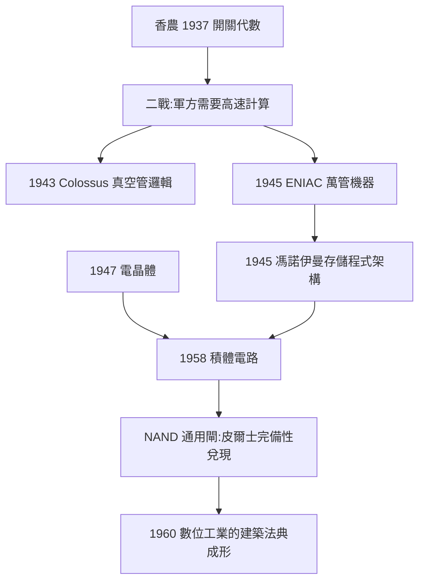

# 5.1 數位電路與邏輯閘（1938–1960）

1938–1960 年，布爾代數從「電路分析工具」升級為「數位世界的建築法典」。繼電器被真空管取代，真空管被電晶體取代，但每一次替換中，**閘級電路的語言始終是布爾的**。這二十二年間，布林的思想完成了從紙面到矽片的物理遷徙。

## 從繼電器到真空管：1938–1945

香農 1937 年的論文（4.3）立刻被電機界吸收。第二次世界大戰把它推向臨界：

- **1943–1944 年**：貝爾實驗室為美軍建造的繼電器計算機（Model I–V 系列）全面採用「開關代數」做電路設計與化簡；
- **1943 年**：英國布萊切利園的 **Colossus**（巨人計算機）用真空管邏輯破譯德國洛倫茲密碼——其電路的組合邏輯本質上就是布爾函數網絡；
- **1945 年**：賓夕法尼亞大學的 **ENIAC** 竣工，約一萬八千支真空管，其加法器、比較器全部由 AND、OR、NOT 閘組合而成；
- **1945 年**：馮·諾伊曼在《EDVAC 報告書的第一份草案》中確立**存儲程式架構**——程式與資料同存於記憶體，而執行程式的運算器（ALU）正是布爾閘的堆疊。

戰爭的因果作用極大：**軍方要高速計算彈道與密碼 → 真空管提供速度 → 布爾邏輯提供唯一可設計性**。沒有邏輯代數，上萬支真空管的電路根本無法被腦力管理。

## 電晶體與積體電路：1947–1960

戰後的器件革命進一步放大了布爾邏輯的統治力：

1. **1947 年**：貝爾實驗室的巴丁、布拉頓、蕭克利發明電晶體——一個理想的可控開關，恰好是布爾變數的物理實現（另見《AT&T》與《Fairchild半導體》資料夾的產業脈絡）；
2. **1958–1959 年**：奇爾比（Kilby）與諾伊斯（Noyce）各自發明積體電路，多個閘可以蝕刻在同一片矽上；
3. **1960 年前後**：**NAND 閘成為通用積木**。這正是皮爾士 1880 年函數完備性觀察（4.1）的工程兌現：任何布爾函數都可只用 NAND 表出，

$$\lnot x = x \operatorname{NAND} x, \qquad x \land y = \lnot (x \operatorname{NAND} y),$$

——一種閘，造出一切邏輯。積體電路製造偏愛這種「單一元件重複萬次」的結構，NAND 完備性與工業邏輯完美咬合。

## 卡諾圖：手工時代的設計工具

1953 年，貝爾實驗室的卡諾（Maurice Karnaugh）發表**卡諾圖**（Karnaugh map）——把布爾函數的真值表排成二維格雷碼網格，使工程師能用肉眼圈選相鄰項、直接讀出最簡表達式。這是布林展開定理（2.2）的人體工學化：**理論上是代數化簡，實務上是畫格子**。直到 EDA 軟體（自動邏輯綜合）成熟之前，卡諾圖是每一代電子工程師的入門儀式。

## 「邏輯閘」的名分

到 1960 年，工程語言已完全布爾化：電路圖上寫的不是「觸點」而是「AND 閘、OR 閘、反相器」；函數用 $F = AB + \bar{A}C$ 這類表達式描述；設計規範直接引用亨廷頓式公理。布林的記號（$xy$、$x+y$、$1-x$）在電機手冊中改寫為 $\land$、$\lor$、$\bar{x}$，但**代數內核一字未變**。

## 事件年表

| 年份 | 事件 | 後續影響 |
|---|---|---|
| 1943–1945 | Colossus 與 ENIAC | 大規模邏輯電路首次實戰 |
| 1945 | 馮·諾伊曼架構草案 | ALU = 布爾閘堆疊 |
| 1947 | 電晶體問世 | 理想開關 = 理想布爾變數 |
| 1953 | 卡諾圖 | 代數化簡的人體工學化 |
| 1958–1960 | 積體電路與 NAND 通用化 | 單一閘重複萬次的工業範式 |

## 小結

1938–1960 年的敘事主軸是「**器件換了三代，邏輯不換**」。繼電器、真空管、電晶體只是布爾變數的三種肉身；存儲程式架構把整台計算機定義為布爾函數的組合。此後，邏輯閘之於數位工程，正如字母之於文學。而這套硬體基礎立刻要求軟體側的對應物——程式語言需要一個「真/假」的原生型別。這就是 5.2 的故事。
