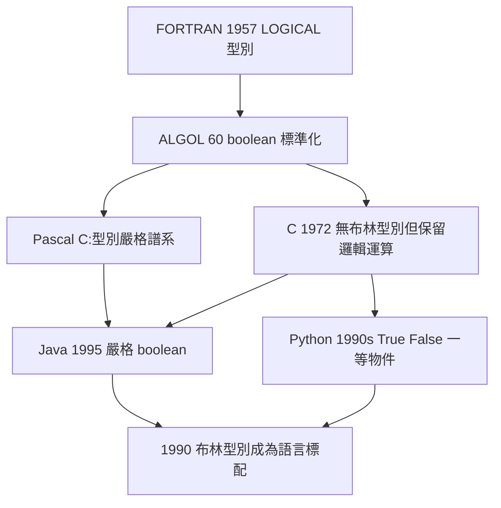

# 5.2 程式語言中的布林型別（1950–1990）

1950–1990 年，布爾邏輯完成了另一次抽象升遷：從電路中的閘，升遷為**程式語言裡的一等公民**——布林型別（boolean type）。`true` 與 `false` 不再只是電壓高低，而是帶著名字的資料值，可以宣告、賦值、比較、返回。這一層抽象，使「判斷」本身成為可編程的對象。

## 開端：FORTRAN 的邏輯型別（1954–1957）

IBM 的 FORTRAN（1954 年啟動，1957 年發布）是最早為高階語言引入**邏輯型別**（`LOGICAL`）的實踐者之一。程式員可以宣告

```fortran
LOGICAL FLAG
FLAG = A .GT. B .AND. C .LE. D
IF (FLAG) GO TO 100
```

`.AND.`、`.OR.`、`.NOT.` 三個運算子正是布爾記號的文字化。注意因果次序：硬體已有布爾閘與條件分支指令（4.3、5.1），FORTRAN 只是把機器的原生能力**翻譯成人類可讀的語法**。語言設計永遠追著硬體的布爾結構走。

## ALGOL 60 與 `boolean` 的標準化

1960 年的 **ALGOL 60 報告**是關鍵的規範化時刻：它明確定義型別 `boolean`，並規定

- 邏輯運算子的嚴格記法 $\land$、$\lor$、$\lnot$、$\supset$（蘊涵）；
- 布林表達式可作為條件語句 `if B then S else S` 的守衛。

→ ALGOL 60 的結構化思想影響了整個歐陸語言譜系；其後 Dijkstra 對「正確性證明」的推動，見《希爾伯特傳記》第 5 章的邏輯證明計畫延伸脈絡。**「程式 = 邏輯命題」的思想，正是布林「思維定律」在軟體時代的迴響**。

## C 語言的「無型別布爾」與務實路線

1972 年的 C 語言走了一條奇特的路：**沒有布林型別**。C 用整數代替——`0` 為假，非零為真；比較與邏輯運算子 `&&`、`||`、`!` 返回 `int`。這條路線的因果解釋：

1. C 的目標是貼近硬體的系統編程，而機器層面只有位元與字組；
2. K&R 時期的極簡主義反對多餘型別；
3. `0/非 0` 約定與組合語言的條件跳轉完全同構。

這證明了布爾邏輯的「滲透力」：**即使語言拒絕命名它，`&&` 與 `||` 的短路求值、真值判定仍然嚴格遵循布林代數**。而且 C 的短路求值引入了布爾代數原本沒有的語義細節——`a && b` 中若 `a` 為假則不評估 `b`——這是「邏輯 + 控制流」的混合體，後來成為許多語言（Java、JavaScript、Python）的標準行為。



## 型別嚴格化：Pascal 與 Java

1970 年代 Pascal 把 `boolean` 定義為列舉型別 `（false, true）` 的序偶，並**禁止整數與布林互轉**——這是對 C 路線的哲學反駁：真值就是真值，不是「非零的數」。這條路線在 1995 年的 Java 中取得工業勝利：

```java
if (flag == true)   // 合法
if (flag == 1)      // 編譯錯誤:布林與整數嚴格分離
```

Java 的選擇背後是**軟體工程的因果邏輯**：大型系統中，「把任何數當條件」是災難性 bug 的常見來源；型別系統強制分離，等於把布林代數的公理**寫進編譯器**。1990 年代以降，C++（`bool`）、C#（`bool`）、Python（`True`/`False` 作為一等物件，甚至是 `int` 的子類）相繼把布林型別列為標配。

## 事件年表

| 年份 | 事件 | 後續影響 |
|---|---|---|
| 1957 | FORTRAN 引入 LOGICAL 型別 | 高階語言布爾化的開端 |
| 1960 | ALGOL 60 標準 `boolean` | 記法與語義的國際規範 |
| 1972 | C 語言以整數代真值 | 務實路線與短路求值 |
| 1970s | Pascal 嚴格布林型別 | 型別安全思想抬頭 |
| 1995 | Java 嚴格 `boolean` | 工業標準確立 |

## 小結

1950–1990 年，布林型別的歷史是一場「**命名與否、嚴格與否**」的拉鋸：FORTRAN 與 ALGOL 命名了它，C 拒絕命名卻不得不實現它，Pascal 與 Java 最終把它鑄進型別系統。不論路線如何，所有語言的條件判斷都運行在 $x \land \lnot x = \bot$ 的定律之上。而當布林值離開單機、進入海量文件的檢索與資料庫查詢時，它又獲得了第三重生命——這是 5.3 的故事。
