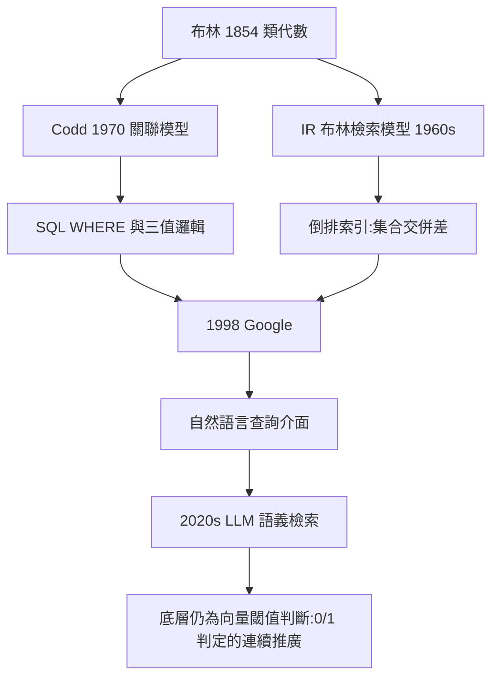

# 5.3 從資料庫到搜尋引擎的布林邏輯（1990–2026）

1990 年之後，布林邏輯的第三重生命展開：它成為**人與海量資訊之間的介面語言**。從圖書館的線上檢索系統（OPAC）、關聯式資料庫的 SQL，到 Google 的搜尋框與現代的大型語言模型，每一次「找到你想要的東西」，底層都是 $x \land y$、$x \lor z$、$\lnot w$ 的運算。布林 1854 年寫下的符號，如今每天被執行數千億次。

## 關聯式資料庫與 SQL：布爾代數的三位一體

1970 年科德（E. F. Codd）提出關聯式模型，1974 年後 SQL 語言定型。SQL 是布爾邏輯的完美容器：

- **WHERE 子句**就是布爾表達式：

```sql
SELECT title FROM books
WHERE (subject = 'logic' OR subject = 'algebra')
  AND year >= 1854
  AND title NOT LIKE '%philosophy%';
```

- **三值邏輯**：SQL 因 NULL 的存在，把布爾代數擴充為「真 / 假 / 未知」的三值邏輯——這是對布林系統一百二十年後的一次語義擴張，顯示其骨架的彈性；
- **關係代數與布爾代數同構**：選擇（$\sigma$）對應篩選條件的合取，投影對應列的重组；集合運算 `UNION`、`INTERSECT`、`EXCEPT` 直接對應 $x + y$、$xy$、$x - xy$（布林 1847 年的原始記號！）。

→ 資料庫產業的擴張脈絡，另見本系列《IBM電腦公司》資料夾。

## 布林檢索模型：資訊檢索的經典起點

1960–1980 年代，資訊檢索（IR）領域把布林邏輯定為經典模型：文件是詞項的集合，查詢是詞項的布爾表達式，匹配規則嚴格。1980 年代圖書館的 DIALOG 系統、醫學文獻庫 MEDLINE 的檢索指令（`AND/OR/NOT`），使「布林查詢」成為一代館員與研究者的通用技能。

但嚴格布林模型有明顯缺陷：**無排序**——滿足與不滿足之間沒有中間狀態。這催生了向量空間模型與 TF-IDF 加權（把 $0/1$ 推廣為連續權重）。有趣的是，這場「超越布林」的運動，本質上是給布林匹配**加概率外衣**——而概率與邏輯的同構，恰是布林 1854 年書名中就宣稱的統一（2.2）。

## Google：布林邏輯的隱形帝國

1998 年 Google 成立。表面上，它把布林查詢「藏」了起來——使用者輸入自然語言即可。但拆開來看，布林邏輯無所不在：

1. **倒排索引**：對每個詞項建立「含有此詞的文件列表」，查詢時對列表做**交集（AND）、併集（OR）、差集（NOT）**——這是在千億規模文件集上執行的集合代數，正是布林類演算（2.1）的工程放大版；
2. **查詢語法**：`site:`、`-詞`（排除 = NOT）、`OR` 等進階語法直接暴露布林介面；
3. **排序層**：PageRank 等排序算法解決「布林匹配之後誰排第一」，與布林匹配層分工合作——**嚴格邏輯篩選 + 概率排序**的雙層架構。



## 2020s：LLM 時代的布爾殘留與新生

大型語言模型（LLM）時代，「搜尋」轉為「生成」，但布爾邏輯並未退場，反而深入更低層：

- **向量檢索**：文件與查詢嵌入為高維向量，相似度超過閾值即召回——閾值判斷本質是連續化的 $0/1$ 判定；
- **硬體層**：GPU 與 TPU 上的每一次矩陣乘法，都由布爾閘構成的 ALU 與加法器執行（5.1）；深度學習的「神經元」啟用函數（如 ReLU）可視為對十九世紀階躍函數（亦是布爾式 $0/1$ 判定）的平滑化；
- **布林可滿足性（SAT）求解器**：現代晶片驗證、軟體形式化驗證、甚至某些 AI 推理系統的核心，都是判斷一個巨大布爾表達式是否有真值指派——**1854 年的 $x^2=x$，在 2026 年驅動著億級變數的工業級求解器**。

## 事件年表

| 年份 | 事件 | 後續影響 |
|---|---|---|
| 1970 | Codd 關聯式模型 | SQL 的布爾 WHERE 文化 |
| 1960s–1980s | 布林檢索模型與線上資料庫 | 檢索技能大眾化 |
| 1998 | Google 成立 | 倒排索引 = 工業級集合代數 |
| 2000s–2010s | SAT 求解器工業化 | 晶片與軟體驗證的核心 |
| 2020s | LLM 與向量檢索 | $0/1$ 判定的連續新生 |

## 小結

1990–2026 年，布林邏輯證明了自己是**跨媒介的通用語言**：在資料庫中是 WHERE 子句，在搜尋引擎中是集合交併差，在 AI 時代是向量閾值與 SAT 求解。每一次媒介革命，人們都以為布爾邏輯會被「超越」，結果它總是成為新媒介的底層文法。回望 1815 年林肯市的鞋匠之家：一個無法上大學的孩子發明了一套「思維定律」，兩百年後，這套定律以每天數千億次的頻率被人類與機器共同執行。這就是「數位邏輯之父」的完整意義——他沒有發明計算機，他發明了**計算機說話的語言**。
