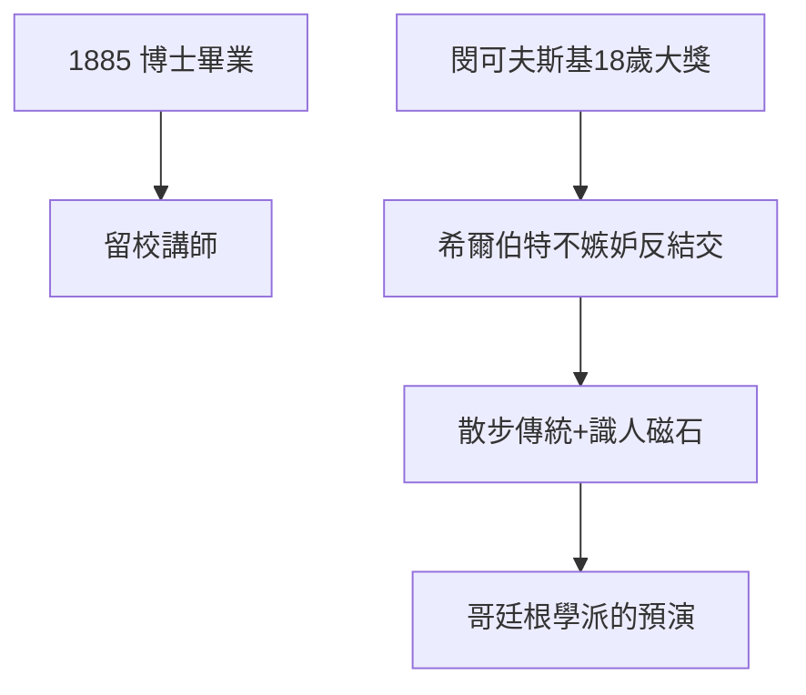

# 1.2 博士與閔可夫斯基（1881–1885）

## 林德曼門下

博士導師林德曼剛證明 π 是超越數（1882），名噪一時。希爾伯特 1885 年以不變量論文獲博士，留校任講師。同期閔可夫斯基 18 歲就拿下法國科學院大獎（與史密斯並列）——天才的光芒讓希爾伯特相形見絀，但他從不嫉妒，反而終身提攜朋友。

## 散步數學

兩人每天下午沿街散步（後來在哥廷根延續為「散步到數學」傳統），無話不談：數論、幾何、物理。這種「走路想數學」的習慣，是哥廷根學派非正式交流文化的源頭。

## 識人的眼光

希爾伯特一生最大的本領之一是識人：閔可夫斯基、克萊因、諾特、外爾、馮·諾伊曼、哥德爾……他像磁石一樣把天才吸到哥廷根。1900 年的巴黎演講（3.1）能成功，一半靠識人，一半靠識問題。

**因果**：博士時代的最大收穫不是論文，是朋友與識人的眼光。閔可夫斯基後來為相對論提供數學語言（1908），正是這段友誼的開花。下一節，不變量戰場見真章。
