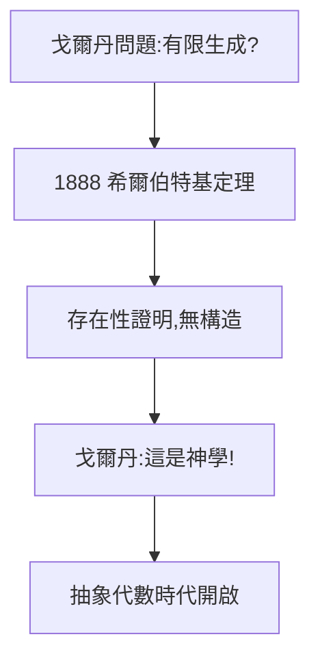

# 1.3 不變量（1885–1888）

## 戈爾丹問題

19 世紀不變量理論的核心難題（戈爾丹問題）：二元形式的不變量能否由有限個生成？戈爾丹本人用構造性計算證明了二元情形，被稱為「不變量之王」。高維情形懸而未決二十年。

## 1888：存在性證明

26 歲的希爾伯特發表**基定理**（Hilbert Basis Theorem）：任何多項式理想都有限生成——用純存在性論證，一舉解決所有維數。戈爾丹怒斥：「這是神學，不是數學！」（Das ist Theologie, keine Mathematik!）——因為證明只說「存在」，沒給出構造。

## 非構造的勝利

- 克萊因、林德曼為他辯護；
- 存在性方法從此登堂入室，20 世紀抽象代數的起點；
- 戈爾丹晚年承認：「我老了，希爾伯特是對的。」

**因果**：慢熱少年（1.1）用一篇論文顛覆一個領域，並確立了「存在即合理」的方法論。這種「不問如何構造、只問是否存在」的風格，將在 1900 年 23 問題（3.1）中發揮到極致。下一章，哥廷根召喚。
