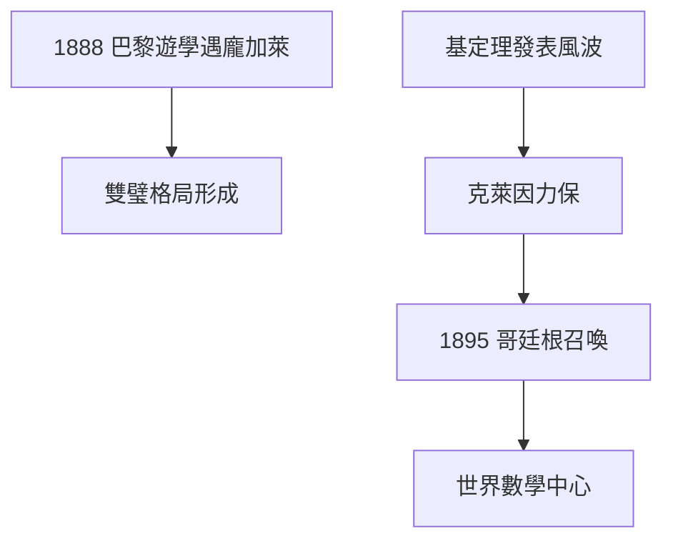

# 2.1 基定理（1888–1890）

## 巴黎之旅

1888 年博士後（Habilitation）完成，希爾伯特遊學巴黎，結識龐加萊、埃爾米特、若爾當。龐加萊的直覺主義風格與他形成對照：一個靠靈感，一個靠結構。兩人互相敬重，成為世紀之交數學的雙璧。

## 基定理的發表風波

《數學年刊》收到基定理論文時，審稿的戈爾丹要求大改。主編克萊因力排眾議發表（刪去最冒犯的部分）。這場風波讓希爾伯特明白：**學術共同體的政治與定理同等重要**——他從此學會經營哥廷根。

## 1895：哥廷根召喚

克萊因把他挖到哥廷根，接替去世的海因里希·韋伯。從此哥廷根成為世界數學中心，希爾伯特是無可爭議的國王。閔可夫斯基 1902 年也來會合，「散步傳統」重現。

**因果**：基定理（1.3）的爭議帶來了克萊因的賞識，賞識帶來了哥廷根的王位。從被審稿人刁難的青年，到決定別人命運的國王——只用了七年。下一節，他將在數論中再下一城。
