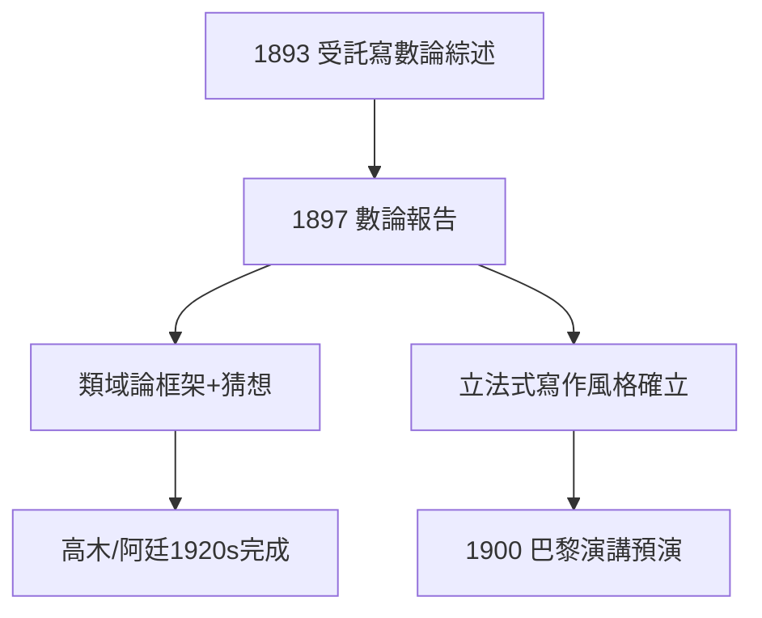

# 2.2 數論報告（1893–1897）

## 《數論報告》

德國數學會委託希爾伯特撰寫代數數論綜述。1897 年出版的《數論報告》（Zahlbericht）不只是綜述：他引入**類域論**的框架、重新證明二次互反律、提出希爾伯特類域的存在猜想——一本「報告」變成未來三十年的研究大綱。

## 類域論的種子

- 克羅內克「青春之夢」（Jugendtraum）：用特殊值生成阿貝爾擴張；
- 希爾伯特將其形式化為第 12 問題（見 3.1）；
- 高木貞治、阿廷最終完成類域論（1920s）——起點是這份報告。

## 風格的確立

希爾伯特的「報告」從來不是總結，而是**立法**：定義概念、提出綱領、指派問題。1900 年巴黎演講是這種風格的登峰造極。

**因果**：從不變量的顛覆者（1.3）變成數論的立法者——希爾伯特證明了他不只會解題，更會出題。下一節，《幾何基礎》將把公理化推向極致。
