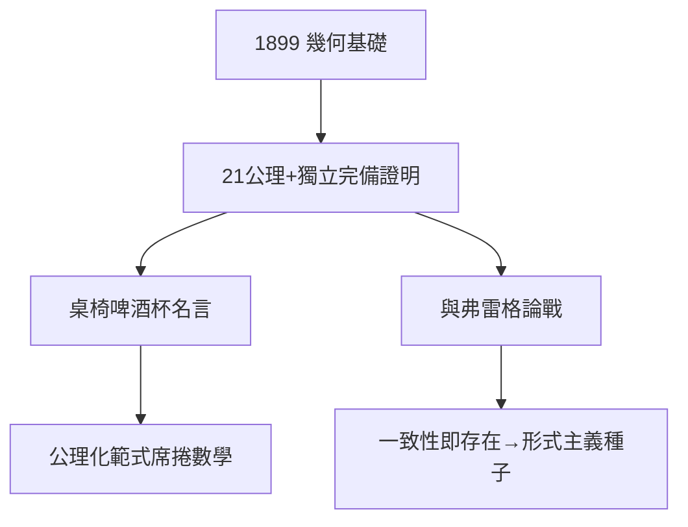

# 2.3 幾何基礎（1899）

## 《幾何基礎》

1899 年，希爾伯特出版《幾何基礎》（Grundlagen der Geometrie），用 21 條公理（關聯、順序、合同、平行、連續）重建歐幾里得幾何，並證明公理的獨立性與完備性。名言：「**我們必須能用『桌子、椅子、啤酒杯』代替『點、線、面』，而幾何依然成立。**」——意義不在對象，在關係。

## 公理化運動的宣言

- 此前帕施、皮亞諾已有公理化嘗試，希爾伯特將其變成範式；
- 此後：物理（與玻恩的公理化嘗試）、邏輯、概率（柯爾莫哥洛夫 1933）紛紛效仿；
- 歐幾里得兩千年的權威，至此被「公理系統」取代。

## 與弗雷格的論戰

弗雷格（現代邏輯之父）批評希爾伯特的公理是「遊戲規則」而非真理。希爾伯特回應：一致性即存在——**無矛盾的公理系統，其對象就是存在的**。這場爭論是第 4 章基礎之戰的序曲。

**因果**：從立法數論（2.2）到立法幾何——1899 年的希爾伯特站在數學之巔，萬事俱備。下一章，1900 年巴黎，他將為整個世紀立法。
