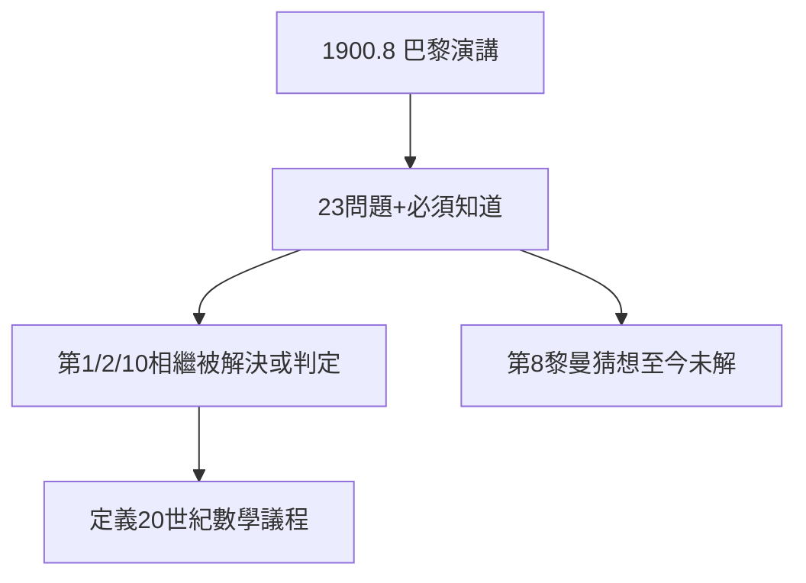

# 3.1 23 問題（1900）

## 1900 年 8 月 8 日，巴黎

第二屆國際數學家大會，希爾伯特發表演講《數學問題》，提出 23 個未解問題（實際講了 10 個，全文 23 個）：連續統假設、算術公理相容性、互反律、丟番圖可解性……演講結尾的名言：「**我們必須知道，我們將會知道**（Wir müssen wissen, wir werden wissen）。」

## 問題的魔力

- 第 1（連續統）：哥德爾 1940 + 科恩 1963 證明不可判定；
- 第 2（相容性）：哥德爾 1931 不完備定理回答（否定的）；
- 第 8（黎曼猜想）：至今未解；
- 第 10（丟番圖）：馬季亞謝維奇 1970 否定解決。

23 題中多數已解決或取得重大進展——出題人的眼光，定義了 20 世紀數學。

## 領航員的加冕

從此「希爾伯特問題」成為數學界的燈塔。龐加萊是當世最深的大腦，希爾伯特是當世最好的領航員——大會證明，**出題比解題更有權力**。

**因果**：數論報告的立法風格（2.2）+ 幾何基礎的公理自信（2.3）= 巴黎演講。希爾伯特從哥廷根國王升格為世界領航員。下一節，積分方程將展示他親自下場解題的功力。
