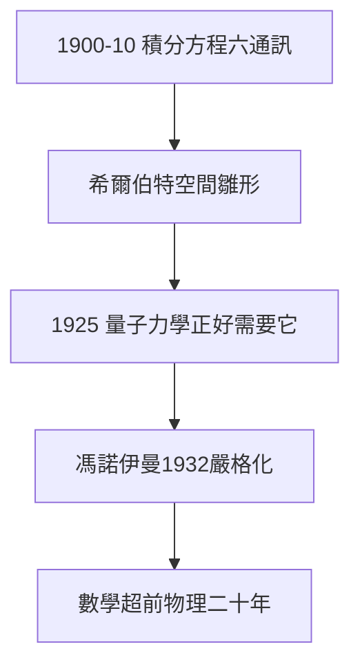

# 3.2 積分方程（1900–1910）

## 1900–1910：六篇通訊

巴黎演講後，希爾伯特親自下場，用十年六篇《積分方程通訊》建立泛函分析的基礎：特徵值理論、譜定理的雛形、**希爾伯特空間**（經施密特、里斯完善）。他證明領航員不只會出題，更會開疆。

## 量子力學的意外嫁妝

- 1925–26：海森堡矩陣力學、薛定諤波動力學都需要無窮維線性空間；
- 馮·諾伊曼（希爾伯特的學生）1932 年用希爾伯特空間嚴格化量子力學；
- 狄拉克說：數學家超前物理學家二十年準備好了工具。

## 方法論：具體問題，抽象結構

希爾伯特的積分方程工作示範了他的信條：從物理與分析的具體問題出發，提煉抽象結構，再回頭照亮更多問題。這種「具體—抽象—具體」的循環，是哥廷根學派的靈魂。

**因果**：1900 年出題（3.1），1900–10 年親自解題——領航員以身作則。而希爾伯特空間在量子力學中的重生，說明「無用」的抽象自有其命運。下一節，他將與愛因斯坦在引力場方程上狹路相逢。
