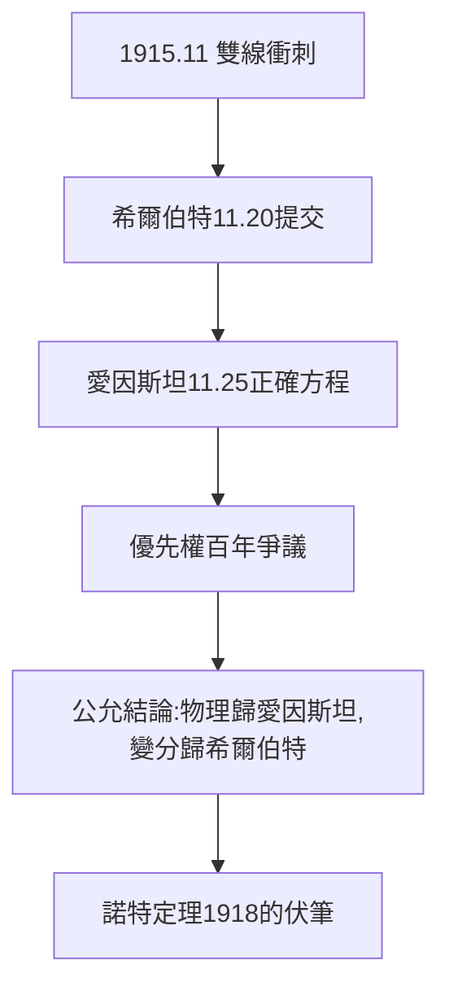

# 3.3 廣義相對論之爭（1915）

## 1915 年 11 月的衝刺

愛因斯坦在柏林、希爾伯特在哥廷根，同時向引力場方程做最後衝刺。11 月 20 日希爾伯特提交論文，11 月 25 日愛因斯坦提交正確方程——相差五天。優先權爭議綿延百年。

## 公允的結論

- 希爾伯特用變分原理（作用量）推導，數學上更優雅，且與愛因斯坦通過明信片交流過想法；
- 愛因斯坦掌握了正確的物理（水星進動的計算驗證）；
- 兩人互相敬重，愛因斯坦說哥廷根之行「讓我確信方程是對的」，希爾伯特從未爭搶命名——方程至今叫「愛因斯坦場方程」。

## 物理學的轉向

此戰之後，希爾伯特把興趣轉向數學基礎（第 4 章），把物理留給物理學家。但他 1915 年的工作（變分原理、能量守恆的討論，諾特定理 1918 正源於此）永遠留在廣義相對論中。

**因果**：積分方程的變分技術（3.2）讓希爾伯特能與愛因斯坦並跑，而這場並跑的副產品（諾特受邀來哥廷根）催生了諾特定理。下一章，戰爭結束，基礎之戰開打。
