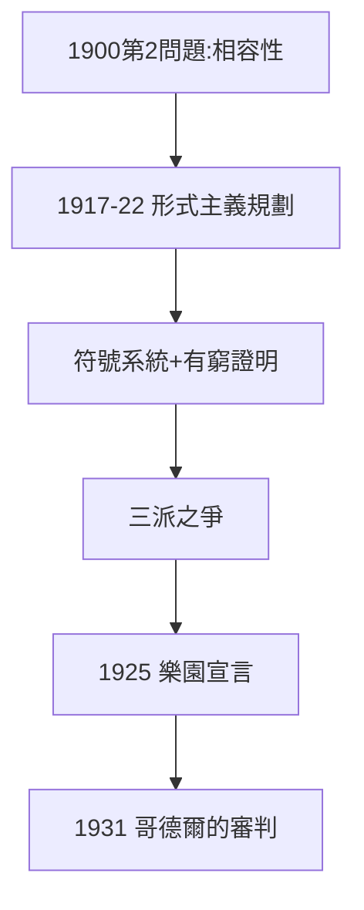

# 4.1 形式主義（1917–1922）

## 希爾伯特規劃

一戰後，希爾伯特提出**形式主義規劃**：把數學寫成有限符號系統，用有窮方法證明其相容性與完備性——為 1900 年第 2 問題（2.3 的延續）給出最終答案。助手貝爾奈斯、學生阿克曼投身其中。

## 三派之爭

| 學派 | 領袖 | 主張 |
|---|---|---|
| 邏輯主義 | 弗雷格、羅素 | 數學 = 邏輯 |
| 直覺主義 | 布勞威爾 | 數學 = 心智構造，拒排中律 |
| 形式主義 | 希爾伯特 | 數學 = 符號遊戲 + 有窮證明 |

希爾伯特的策略是「兩面作戰」：吸收直覺主義的構造要求（有窮方法），保衛古典數學的全部領土（「**無人能把我們從康托爾創造的樂園中驅逐**」）。

## 樂園宣言

1925 年演講《論無窮》：「從康托爾為我們創造的樂園裡，無人能驅逐我們。」——這是形式主義最壯麗的誓言，也是哥德爾將要擊碎的夢（見 4.3）。

**因果**：從「一致性即存在」（2.3）到「證明一致性」——希爾伯特要用三十年前的哲學立場，兌現為技術規劃。而布勞威爾不會束手就擒，下一節開戰。
