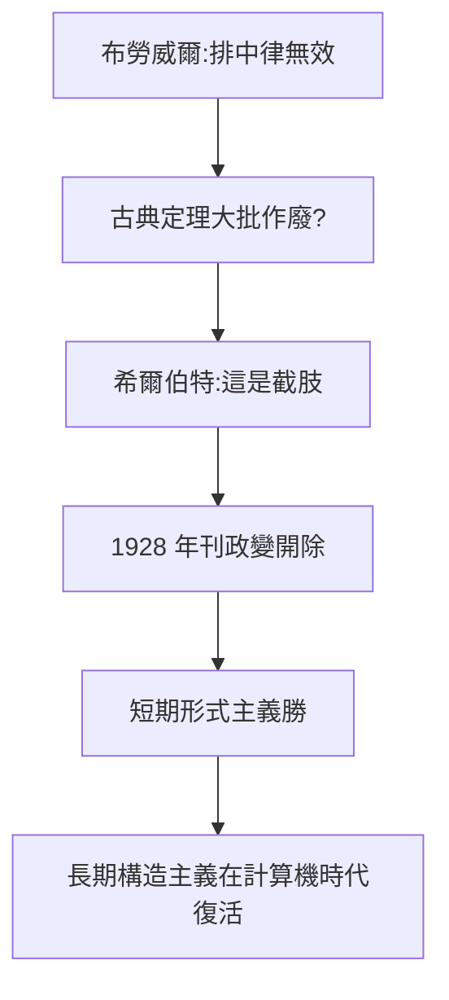

# 4.2 與布勞威爾之爭（1920–1928）

## 排中律之戰

布勞威爾宣稱排中律（ $P \lor \lnot P$ ）在無窮集合上無效，大批古典定理（用反證法證存在性的）都要作廢。希爾伯特視之為對數學的截肢，親自下場論戰，稱之為「數學的內戰」。

## 《數學年刊》政變（1928）

希爾伯特利用主編權力，把布勞威爾逐出《數學年刊》編委會——學術史上最著名的「開除」之一。愛因斯坦（同為編委）私下抱怨，卻無力阻止。布勞威爾從此與哥廷根決裂，轉向 Amsterdam 自立門戶。

## 勝負的辯證

- 短期：希爾伯特贏了建制，形式主義主導 1930 年代；
- 長期：構造性數學（直覺主義後裔）在計算機時代復活——類型論、證明助手（Coq、Lean）都是布勞威爾的隔代遺產；
- 學術政治污點：開除事件是希爾伯特一生唯一的道德爭議。

**因果**：形式主義規劃（4.1）需要統一戰線，布勞威爾成了必須清除的異端。但歷史開了玩笑：被開除者的思想在計算機時代借屍還魂。而更大的審判（哥德爾）已經在路上。
