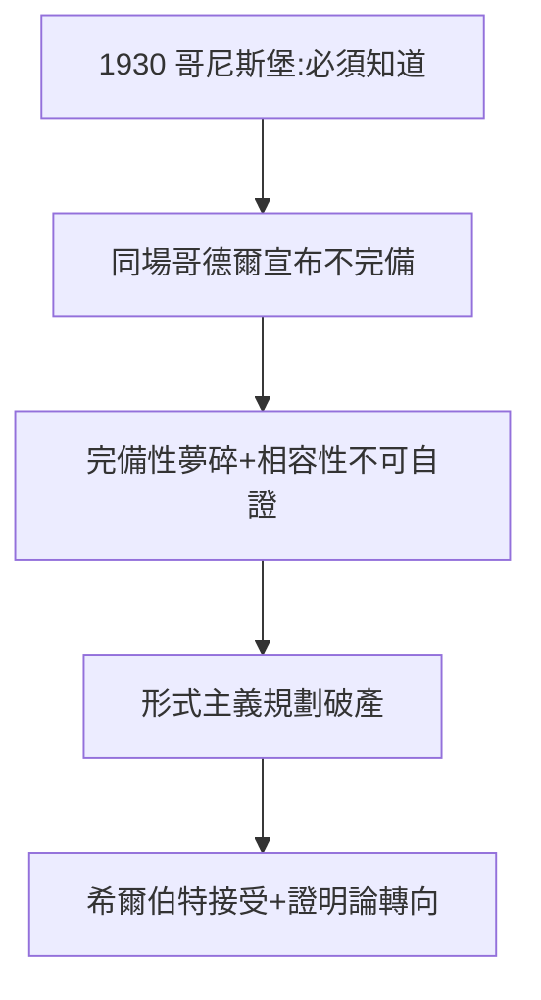

# 4.3 哥德爾 1931

## 1930 年 9 月，哥尼斯堡會議

希爾伯特的故鄉哥尼斯堡舉行科學會議，他發表退休演講，重申「我們必須知道，我們將會知道」。同一會場，一個 24 歲的維也納青年哥德爾在討論環節輕描淡寫地宣布：**任何包含算術的一致形式系統都不完備，且不能自證相容**。

## 不完備定理

$$\text{若 } T \text{ 一致且包含 PA} \Rightarrow \exists G\,(T \nvdash G \land T \nvdash \lnot G)$$

- 第一不完備：完備性夢碎；
- 第二不完備：相容性不能自證——第 2 問題（1900）的規劃破產。

## 希爾伯特的反應

傳說他初聞大怒，後接受現實，轉而支持相對化的規劃（證明論的後續發展：根岑 1936 用超窮歸納證明算術相容）。他的氣度在此：**被證偽時不護短**——這正是科學精神。

**因果**：從 1900 年第 2 問題（3.1）到 1931 年答案——31 年的規劃被 24 歲青年終結。但「希爾伯特規劃」的殘骸養活了證明論、遞歸論、計算機科學。失敗的規劃，成功了一門學科。下一章，納粹來了。
