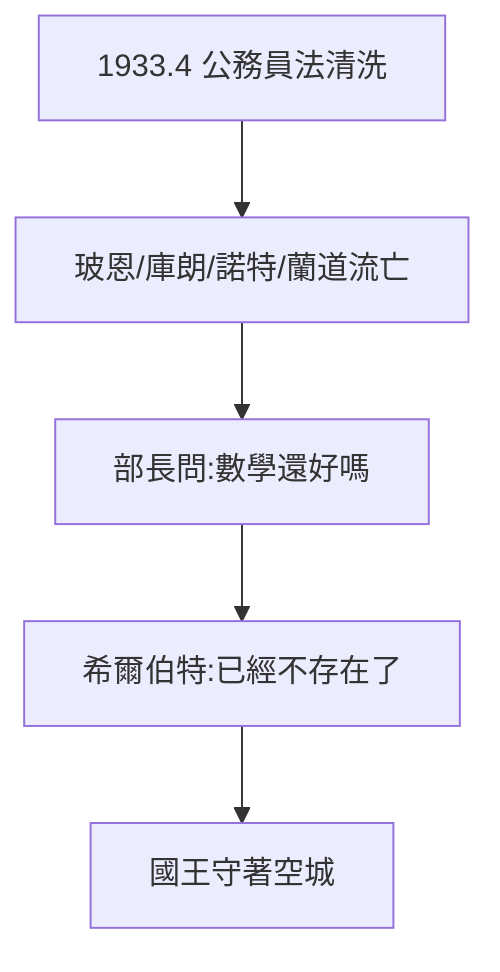

# 5.1 哥廷根的毀滅（1933）

## 1933 年 4 月：清洗

納粹《重建公務員法》驅逐猶太學者：玻恩、庫朗、諾特、蘭道……哥廷根數學一夜清空。教育部長問希爾伯特：「哥廷根的數學還好嗎？」他回答：「**沒有了。已經不存在了。**」（Es gibt keine mehr.）——最沉痛的墓誌銘。

## 諾特的遭遇

埃米·諾特（抽象代數之母，希爾伯特力保她取得教職：「這裡是大學，不是澡堂」）流亡美國，1935 年死於手術。希爾伯特晚年常念及她——他識人（1.2）的最後見證，是沒能留住她。

## 國王的孤獨

昔日門庭若市的哥廷根，只剩空教室。希爾伯特每天仍去散步，但散步的同伴或死或亡或流亡。1930 年代的哥廷根，是 1900 年巴黎（3.1）的反面。

**因果**：他用四十年建成的哥廷根（2.1），納粹用四個月拆毀。1.2 的「識人磁石」在種族法律面前毫無用處。下一節，回到 1930 年那句「必須知道」——在黑暗年代重讀，別有意味。
